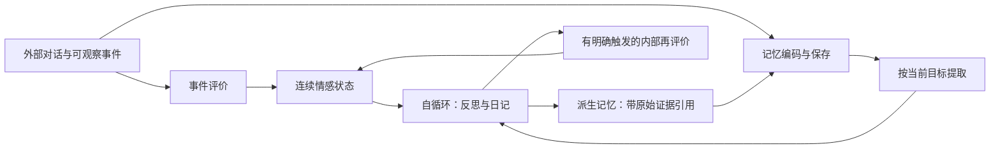

# 情感函数如何更像人：论文、源码与修改建议

日期：2026-10-31。范围：你列出的六组情感函数与常量，以及判断其语义必需的少量调用点。源码位于 `D:/AI/castalia/Castalia-Anima/src/`。本轮只研究、运行纯函数探针和撰写报告，没有修改运行时代码、数据库或部署。

## 1. 判断

**保留现有连续状态内核，修改它的输入语义和动力学；暂时不再叠加一套“开心→生气→伤心”的互斥标签状态机。**

目前不像人的主要原因，不是状态数量少，而是几种不同对象被当成同一种数字：一句话的词汇倾向、事件对角色的影响、角色当前心境、当时形成记忆的感受、现在想起它的感受。继续调半衰期或增加标签，会把这些混淆固化。

更值得做的是：

1. 明确“发生了什么、对谁、影响什么目标”，再更新情感；不能直接让负面词等于角色受伤。
2. 区分短时情绪反应、较慢心境与长期关系/记忆痕迹。记住一次伤害，不等于此后一直保持当时的愤怒。
3. 让恢复速度受事件重要性、目标是否仍未解决、重新想起和调节过程影响，而不是受“傲娇浓度”直接控制。
4. 保留记忆循环与自循环的分离。日记可以入库，但其内容是有来源的解释，不能循环升级成新发生的外部事实。
5. 先修量尺、中性语义和时钟，再考虑增加复杂度。当前已有几处确定性反例，足以影响拟人感。

这些建议是面向“行为和时间轨迹更像人”的工程方案。论文支持其中一些机制，不会直接给出本角色应使用的唯一公式或参数。

## 2. 论文真正支持什么

### 2.1 基线、敏感度与恢复速度应当分开

Kuppens 等的 DynAffect 将情感动态区分为情感基点、波动/敏感性和回归基点的吸引强度，在两项体验取样研究中建模。[P01]

对代码最直接的启发是：

| 心理机制 | 对应工程参数 | 不能混用的东西 |
|---|---|---|
| 平时的情感倾向 | baseline `μ` | 当前事件的正负 |
| 对具体事件反应多大 | appraisal → impact 的增益 | 平时是否乐观 |
| 情绪恢复多快 | 按真实时间计算的恢复率 | 说话次数、检索次数 |
| 如何表达感受 | 回应策略、语气约束 | 内在感受本身 |

一个角色可以平时积极、对背叛很敏感、恢复缓慢、表达克制。这四件事没有必要由一个 `tsundereLevel` 同时决定。

现有指数均值回归可作低成本近似。它没有扩散噪声，不应被称为完整的 Ornstein–Uhlenbeck 随机过程；也不必为“像人”而立刻加随机噪声。

### 2.2 情绪持续时间不是 V/A/D 三个固定半衰期

Verduyn 等发现，事件重要性、初始强度及刺激实际或在脑中再次出现，与情绪持续时间有关。[P02] Brans 与 Verduyn 则区分了情绪强度和持续时间：二者不是同一指标；评价过程和调节策略的预测作用也不同。[P03]

源码注释引用的 Verduyn & Lavrijsen 研究比较的是不同情绪经历的持续时间，强调事件重要性和反刍。[P04] **它不支持 `valence=24h / arousal=4h / dominance=36h` 这三个普适常数。**

因此，24/4/36 可以作为待检验的产品初值，但必须删除“论文规定这些值”的解释。区分“短暂惊吓”“一天心情差”“对某人的信任下降”，比寻找一个统一的人类半衰期更有效。

### 2.3 连续情感维度有用，但不能唯一解码情绪

Russell 区分了核心情感与有对象的情绪经历。[P05] PAD 是一种描述框架，不能凭三个坐标就唯一恢复责任归属、对象、目标和情境。[P06]

例如，相近的负效价、高唤醒，可能对应恐惧、愤怒、焦虑或兴奋中的不适；要区分，往往还需要“谁造成的、能否应对、什么可能发生”。Cowen 与 Keltner 的研究也显示类别与连续梯度可以并存，并不要求二选一。[P07]

Larsen 等研究了快乐和悲伤同时存在的情况。[P08] 因而，纯标量平均可能把“高兴却舍不得”压成 0；这个 0 不等于毫无情绪。

工程上可继续用 VA 表示核心情感，用有来源的 appraisal 补充对象、目标和可控性。具体情绪词作为派生描述，允许多个词或暂不命名。不要把 `dominance` 顺手当作信任、模型置信度或事件可控性的同义词。

### 2.4 选择 appraisal 架构，是工程选择，不是心理学唯一共识

Scherer 的成分过程理论强调多种评价检查。[P09] Barrett 的构建情绪理论则从预测、内感受和概念化解释情绪，并对某些传统“刺激→评价→情绪”解释提出不同看法。[P10]

本报告采用“观测→事件评价→状态更新”作为可审计的软件分解，不宣称它完整复刻人脑，也不把不同理论都说成同一条流水线的证明。

### 2.5 越不稳定、越记仇，不等于越像人

Houben 等的元分析涉及 79 项研究、11,381 人，讨论波动、不稳定性、惯性与心理幸福感的关系。[P11] Dejonckheere 等发现，一些复杂动态指标对幸福感的预测，在均值和方差以外增加的信息有限。[P12]

它们不能证明动态对角色无用；但足以提醒：不能把“更长的负情绪、更大的波动、更多内部参数”直接当作拟人感进步。需要具体情境和人类评价来判断。

## 3. 状态机到底要不要加

**需要状态，但现有 `psycheState` 已经承担了这个职责。建议升级它，不再另建互斥情绪 FSM。**

适合确定性代码维护的状态包括：当前连续情感、更新时刻、上次证据时刻、尚未解决的目标、事件去重、事件来源，以及有限的关系估计。适合派生的包括：`positive/negative/neutral`、展示标签和本轮语气。

“有状态”使同一句话在不同历史下有不同含义；“离散标签跳转”本身并不产生这种理解。比如：

> 一次冷淡后道歉，可以让当下紧张减轻，但信任不必立即复原；之后普通聊天也不应把伤害重新发生一次。

要表达这一点，至少需要事件原因、快慢变化和关系对象。只增加 `hurt → apology_received → happy` 的跳转表，很容易制造另一种机械感。

`bandFor` 的迟滞值得保留，用来避免展示闪烁。但它应当读取连续状态，不应反过来把连续心境清零，也不应决定某个绝对 valence 是否被允许传给检索。

## 4. 六组函数复核

### 4.1 `psycheState.ts`：保留内核，先修接口语义

源码：[psycheState.ts](D:/AI/castalia/Castalia-Anima/src/psycheState.ts:56)。

| 函数/常量 | 判断 | 修改建议 |
|---|---|---|
| `DEFAULT_PSYCHE_BASELINE` | 保留“基线”概念；`.4/.3/.6` 是角色设定 | 与其他模块共用明确量尺的配置；人格倾向不自动等于 VAD 偏移表 |
| `DEFAULT_HALF_LIFE` | 指数恢复可保留，具体数值无现成人体验证 | 改为按状态层定义的恢复参数；先通过对话轨迹选择，不声称普适 |
| `DEFAULT_EVIDENCE_TTL_HOURS` | 是证据管理参数 | 证据过期应降低可信度；不能把 72h 当作情绪自然死亡时刻 |
| `readPsycheTuning` | 可配置正确，但 env 化不等于校准 | 验证半衰期 `>0`、增益在范围内、`0≤hold<enter`；拒绝空字符串等意外配置 |
| `clamp` | 保留作边界保护 | 超界同时保留诊断；钳位不能掩盖传感器系统性失真 |
| `finite` | 边界语义需收紧 | 当前 `Number(null)`、`Number('')` 会成为 0；未知维度不应变成真实的零观测 |
| `bandFor` | 迟滞合理，阈值为工程值 | 区分“绝对愉悦程度”和“相对平时的变化”；派生标签与调用方使用同一解释 |
| `decay` | 公式正确 | 保留按 `dt` 的指数恢复；本轮核心数学不必重写 |
| `createPsycheState` | `hasEvidence=false` 与基线初始态合理 | 初始未知与情绪中性继续分开；不能把默认基线当作实测证据 |
| `transitionPsycheState` | 纯函数、时间单调、去重值得保留 | 将事件增量和状态观测严格分开；修复 `neutral` 标签覆盖；后续再拆快慢层 |
| `appraisalFromVAD` | 仅在输入真的是事件影响时成立 | 事件的零影响与状态的零坐标不是同一种“中性” |
| `targetAppraisalFromVAD` | 仅在输入真的是绝对状态观测时成立 | 不能为避免累加，就把词汇倾向或批次事件评价改名为绝对心境 |

**现行路径的重要问题：输入到底测什么，仍不够确定。** `emotion.ts` 的提示要求估计互动对 Anima 目标和关系的影响，又要求输出“当前互动状态”；随后 `targetAppraisalFromVAD` 把它当成绝对 VAD 目标。词表批次均值也走 target。

“将重复绝对读数朝目标靠拢”比反复累加好，但前提是读数真的是绝对状态。对于事件评价，应输出事件影响，并对同一事件去重；对于真正的状态观测，则使用有界误差更新。两者需要不同适配器，不能只靠调 `.35/.55` 解决。

#### 中性覆盖不是正常恢复

`transitionPsycheState` 收到有效 `neutral` 时不修改 VAD，却立即把 `band` 置为 neutral；后续 `no_event` 还可能继续保持该标签。

如果输入表示“这轮没发生明显情感事件”，旧心境应继续按时间演化。如果输入表示“观察到角色现在确实平静了”，它才可以作为状态观测，推动数值向定义清楚的中性区域变化。现在这两种意义挤在一起。

#### 相对状态与绝对状态不能混接

`bandFor` 比较 `v−μ`，而 [index.ts](D:/AI/castalia/Castalia-Anima/src/index.ts:67) 在 band 非 neutral 时返回绝对 `v×10`，neutral 时返回 0。

例：`μ=.4, v=.1`，相对平时是 `−.3`，band 可以是 negative；传给情绪检索的 scalar 却是 `+1`。

这并非“人不可能低于平时却仍略愉悦”。恰恰相反，两者可以同时成立。问题在于接口把相对标签、绝对数字和中性门控拼成了一个值，消费者不知道它代表哪一个。

建议明确暴露：`absoluteValence`、`deviationFromBaseline`、`arousal`、`evidenceStatus`。检索如需要当前绝对心境，就直接使用对应值；不要先按相对 band 把它清零。

### 4.2 `emotion.ts`：拆开恢复、记忆与表达

源码：[emotion.ts](D:/AI/castalia/Castalia-Anima/src/emotion.ts:67)。

| 函数/常量 | 判断与建议 |
|---|---|
| `AIRI_BASELINE` | 与 psyche 的默认基线存在独立定义。统一配置来源及量尺；`sharp/resourceful/noNonsense` 到 VAD 的手填偏移只能作为角色设计，不能称心理测量结果 |
| `HALF_LIFE` | 实际被当作时间常数 `τ`；修正公式或改名。撤掉 24/4/36 来自 Verduyn 的依据声明 |
| `NIGHT_MULTIPLIER` | 暂停用于整个记忆年龄。夜间不是睡眠，固定三维倍率没有对应证据 |
| `TSUNDERE_SLOWDOWN_MAX` | 取消其作为通用恢复律的地位。傲娇表达、主观反应和持续性应分别配置 |
| `REGRESSION_RATE` | `.05/调用` 不适合作真实时间恢复参数；若保留，仅限固定模拟步长并明确步长 |
| `computeDecay` | 先定义它算“现在重体验的感受”还是“提取容易程度”；不要在一个结果里兼任所有机制 |
| `decayDimension` | 若名为半衰期，采用 `2^(−dt/H)`；若名为时间常数，则保留 `exp(−dt/τ)` 并统一单位 |
| `isNightTime` | 可用于作息调度或显示，不直接作为“正在睡眠”的证据 |
| `regressToBaseline` | 本次 `src` 检索未发现调用，只有定义与遗留导入。属于待清理/接入风险，不能说它正在与 psyche 双重回归 |
| `computeBaseIntensity` | 三维绝对值均值不适合作通用情绪强度；尤其低唤醒负端会被绝对值变强。显著性与控制感也不应直接等价 |
| `computeRecency` | `exp(−h/36)` 可作工程近因项；参数名 halfLife 不准确，而且它不应复用 dominance 的语义 |
| `EMOTION_SMOOTH_ALPHA` | 当前平滑值用于兼容读数/状态信息，psyche 接收到的是 `result.vad` 原值。不能误报成 `.3×.55` 的串联平滑；建议明确其唯一用途 |
| `vapToPlutchik` | 是手工 sigmoid 乘积，不是 KNN；只能当未校准的展示启发，不能作为情绪概率或状态真值 |
| `sigmoid` | 数学工具本身保留；经过 sigmoid 不代表输出已经成为概率 |
| `summarizeLocalAffect` | 批内平均可作粗线索，但丢顺序、对象和混合情感；不要直接当角色的绝对心境 |

#### 两套时钟：需要统一定义，不需要强行变成一个时钟

`psycheState.decay` 算当前状态恢复到基线；`emotion.computeDecay` 被检索用于处理记忆中保存的 VAD。两者对象不同，因此不同参数本身不构成错误。

应统一的是：坐标含义、单位、半衰期与时间常数的命名、来源说明。应保留区分的是：

- 事件当时的感受：历史记录，不能随着时间把原文事实改写。
- 当前能否容易想起：由线索、频次、近因等决定。
- 此刻想起时的感受：可以因解释、关系变化和调节而改变。[P14]

因此，“旧记忆 VAD 越来越趋近零”最多是某种重体验/提取权重的近似，不能同时被解释为记忆本身消失和当前心境恢复。

#### 夜间开关有确定性不连续

现行调用把“查询此刻是否夜间”用于整个 `hoursSinceCreated`。一个保存 24h 的旧事件，在 21:59 和 22:00 会被套用不同的全程衰减倍率；dominance 甚至可能在入夜时突然回升。

如果未来确实要模拟睡眠，至少需要实际睡眠/清醒状态及分段经过的时间。Borbély 的睡眠模型区分稳态睡眠压力与昼夜过程；Boivin 的实验说明情绪与昼夜相位、清醒时间的关系更复杂。[P20–P21] Palmer 等的元分析也不支持“缺觉一律高唤醒”：正情感、焦虑和刺激反应受到的影响并不相同。[P22]

第一版直接停用这组倍率，比建立未经验证的夜间心理规律更合适。

### 4.3 `affectLexicon.ts`：保留廉价线索，降级它对状态的权限

源码：[affectLexicon.ts](D:/AI/castalia/Castalia-Anima/src/affectLexicon.ts:24)。

| 函数/常量 | 修改建议 |
|---|---|
| `LEXICON` | 标注为人工启发词表；增加最长匹配/重叠消解；将词语关联、句子表达和事件评价分开 |
| `INTENSIFIERS` | 处理明确作用域，避免凭前两字和遍历顺序决定程度；系数需要中文样本检验 |
| `NEGATIONS` | 不再统一翻转 v/d；至少处理否定作用域、程度衰减和固定词。没有把握时拒判 |
| `scoreAffect` | 输出词汇证据和可判断范围；引语、主体、对象、转折不清时，不直接更新角色情感 |
| `affectIntensity` | 与统一后的强度定义同步，不能继续依赖三维绝对值均值 |
| `affectImpact` | 保留 0–10 转换时明确其含义；它不是事件重要性、发生概率或检索强度 |
| `round2` | 保留格式化功能；内部计算尽量最后才舍入，不制造虚假的测量精度 |

**量尺必须先统一。** 此处 arousal 明写 `0..1`，情感模型/psyche 路径采用另一套 `−1..1` 表示，而检索 `AffectVector` 又要求 `0..1`。这些值不能直接互相传递。

建议内部协议采用 `V∈[−1,1]、A∈[0,1]`，可选控制感另保留一维。若旧 A 确实是从低唤醒到高唤醒的双极编码，转换才是 `A_new=(A_old+1)/2`；相应基线也必须转换。不能只改 TypeScript 注释，或对所有来历不明的 A 都做该变换。

NRC VAD 与 Warriner 词表说明：词级维度可以通过人工标注建立规范。[P23–P24] 它们不证明一套约四十词的中文手填数值准确。VADER 的价值在于对否定、程度、转折等组合规则进行检验，而不只是词汇数量。[P25]

“对不起”带负面词汇关联，并不意味着收到道歉的角色应该更难过。事件影响依赖谁道歉、为什么、是否可信、是否回应了原来的伤害。这是词典难以独立承担的部分。

另一个需改名的量是 `confidence=.25+.15×hits`。命中越多可以表示“更多词汇线索”，不能当作实际正确率；重复词和重叠命中还会把它推高。

### 4.4 `emotionalRanking.ts`：借鉴认知机制，不把常数当人类定律

源码：[emotionalRanking.ts](D:/AI/castalia/Castalia-Anima/src/emotionalRanking.ts:56)。

| 函数/常量 | 判断与建议 |
|---|---|
| `SALIENCE_WEIGHTS` | 五项可解释的工程起点，`.30/.20/.20/.15/.15` 无对应普适心理学比例；保持可消融 |
| `ACTR_D` | `.5` 可作常见起点，需固定时间单位；不代表所有记忆同一种遗忘速度 |
| `ACT_SLOPE / ACT_OFFSET` | 明确是排序标定值；必须与时间单位一起保存。当前注释的 30 天分数与实际公式不符，见探针 |
| `baseLevelActivation` | 保留频次/近因机制；它不是完整间隔效应模型。应记录真实呈现/成功回忆，而非所有系统读取 |
| `activationScore` | 绝对映射优于强迫每批候选产生一个“最强”记忆；但输出不是人类回忆概率 |
| `moodFromScalar` | 停止用 `abs(valence)` 伪造 arousal；传真实 VA，缺失维度就不参与该项 |
| `moodCongruence` | 保留为弱偏向；加入当前目标、调节意图和多样性约束，不能把低落永远导向负回忆 |
| `resonanceBoost` | 可以保留有界联想项；当前调用方用 edges 构造关联，不是实验测得的 Hebbian 学习。需要区分关联类型和重复来源 |
| `rankBySalience` | 保留可分解打分；`pinned→1` 应拆成存储保留、身份约束和本轮提取优先级 |
| `injectionPolicy` | 按分数控制是否主动提及有用；“低落时不提中等显著记忆”只是产品策略，不是心理定律 |
| `bjorkDecay` | 双强度概念可参考，`72×(1+3S)` 是自拟公式；暂不与 ACT-R 并行叠加接入 |
| `bjorkUpdate` | 只对确实成功的回忆使用 retrieve 更新；遗忘越多不等于无条件学得越牢。没有成功提取时需区分重见原文 |
| `bjorkStrength` | 当前合并公式产生较高永久分数下限；建议存储强度影响重学收益/保持策略，而不永久托高所有检索分 |

**先修正三种理论外推。**

第一，ACT-R 基础激活 `ln Σt^(−d)` 可表达呈现频次和近因，但固定 `d` 的求和不等于完整解释间隔学习。Pavlik 与 Anderson 的模型让各次呈现的衰减与学习时的激活有关；Cepeda 等的元分析还说明间隔收益依赖保留时长。[P16–P18]

第二，Bjork 的“存储强度/提取强度”是值得借鉴的区分，不等于源码中的具体函数已经获得实验支持。[P15] 本次 `src` 检索没有发现这三个 `bjork*` 函数的调用，因此其下限问题属于**接入前的设计问题**，不是已经在主链运行的事实。

第三，唤醒不应让所有记忆都统一加分。Mather 与 Sutherland 的唤醒偏向竞争观点，强调唤醒会放大高优先级信息的竞争优势。[P13] 当前目标与内容优先级需要参与，不能只有“情感强度越大越重要”。

#### “自己读了一次”何时算强化

现有 `shouldReinforce` 限定用户主动提起/显式回忆等渠道，是值得保留的防反馈设计。

从拟人角度说，内部复述当然也可能产生学习；但软件把一条记录塞进 prompt，不代表角色真正注意、成功回忆或重新解释了它。第一版继续不给自动注入计数；未来如开放“主动回忆”，需单独记录触发原因、注意/使用结果、原始事件 ID 和时间。

#### pinned 的三种职责要拆开

- 身份或明确承诺：可以是稳定约束。
- 重要事件：应避免被删除，但未必每轮都提起。
- 当前对话相关的记忆：才需要竞争本轮上下文预算。

`pinned` 永不遗忘，不必然推出无条件持续注入。人会长期记得某次告白，也会在修电脑时只谈电脑。

#### 一个窄范围调用问题

在 [recallForInjection.ts](D:/AI/castalia/Castalia-Anima/src/recallForInjection.ts:327)，目前只过滤 `context-only`，并没有按 `skip` 排除候选；被过滤的内容也没有在这里转成背景。所以上表是对函数策略的建议，不能假定它的四种返回值已经完整落地。这个调用点应与函数契约一并修正。

### 4.5 `search.ts`：保持匹配主轴，减少情感因素重复解释

源码：[search.ts](D:/AI/castalia/Castalia-Anima/src/search.ts:142)。

| 项目 | 修改建议 |
|---|---|
| `WEIGHT_CONSISTENCY=1.00` | 保留基础匹配主轴；不同召回通道的 similarity 含义需要明确，不把所有值当作人格一致性 |
| `WEIGHT_EMOTION=.12` | 保留为待校准小项；先修强度定义，别先加大权重 |
| `WEIGHT_TIME=.15` | 明确表示最近可提取性；与 ACT-R 共同存在时做消融，检查是否重复偏爱新近/常提内容 |
| `WEIGHT_DEVIATION=.10` | “不像平时但情绪强烈”可以有意义，但也可能是误标；需要原始证据质量约束 |
| `computeEmotionalIntensity` | 当前实际调用旧 `computeDecay` 与夜间开关，是优先修改的入口 |
| `computeScore` | 现有有界元数据增益值得保留；不要让情绪显著性替代事实相关性与证据资格 |
| `salienceBlendFactor` | 保留当前 `0.9..1.1` 有界重排，先修各输入再拟合权重 |

需要准确描述现状：显著性重排已经改用保存的基础强度，而非再次使用同一份衰减后的强度。不能笼统说“所有路径都重复衰减”。但基础分中仍有近因项与旧情绪衰减，重排又有 ACT-R，是否有多重近因偏置需要消融验证。

情感记忆仍需要相关性、事实正确性和召回覆盖率评估。它们与“什么时候提、怎样提”是两类必要指标，并不互相替代。

### 4.6 `agentState.ts`：标量 mood 降为兼容，energy 改为独立时钟

源码：[agentState.ts](D:/AI/castalia/Castalia-Anima/src/agentState.ts:123)。

`getCurrentMood` 的事件衰减求和在“每个 value 真的是独立事件影响”时可以作为简单模型。不能把每轮对同一心境的绝对评分都放进去，否则会因为测量次数增加而饱和。需要明确来源、去重和幅度边界。

现有 psyche 和 legacy mood 不宜永远并行竞争。短期可保留兼容回退，但应统一观测定义；证据 TTL 到期后突然换另一套 mood 算法，会发生与新事件无关的状态跳变。

`getCurrentEnergy` 需要更明确修改：

- 只有消耗 `energy×exp(−.05h)`，没有休息恢复；注释说的 interaction reset 实际部分来自共享时间戳。
- `setDesire`、`addMood` 和能量共用 `lastUpdated`，更新时间戳前未先结算能量。改一个想法，就可能让显示能量从约 30 回到 100。
- 应建立独立 `energyUpdatedAt`，先结算到当前时刻，再修改精力；休息/睡眠或合意活动提供明确恢复事件。
- 精力、困倦和 arousal 分开：人可以疲惫却焦虑，也可以精力充足却平静。[P20–P22]

如产品确实需要日夜节律，可做简化的睡眠压力/作息机制。不要为了拟人先实现完整生理模型。

## 5. 本轮实际执行的纯函数探针

直接从当前 TypeScript 读取并剥离类型；词表、显著性模块直接执行，psyche 与旧 emotion 仅截取纯函数区段，移除导入以避免加载 DB。没有启动服务、调用模型或读写运行数据库。

脚本：[affect_review_probe.mjs](D:/AI/hermes-home/cache/scratch/affect_review_probe.mjs)。原始结果：[affect-function-probes-2026-10-31.json](D:/AI/castalia-AIRI/docs/affect-function-probes-2026-10-31.json)。

| 探针 | 当前实测结果 | 意义 |
|---|---|---|
| 相同名义 24h 参数，经过 24h | 旧式剩余 `.367879`；psyche 剩余 `.5` | 一个是时间常数，一个才是半衰期 |
| 24h 旧记忆 A，仅切换夜间开关 | 白天 `.00247875` → 夜间 `.00000001523` | 查询时刻重新解释整个过去，发生不连续 |
| 同一探针的 D | `.513417` → `.716531` | 入夜反而突然增强；不是新事件导致 |
| `A=−1` 与 `A=+1`，其余为零 | 强度都为 `.333333` | 低唤醒与高唤醒被绝对值当成等强 |
| 先向负目标更新，再输入 neutral | `V=−.37` 保持不变，band 从 negative 变 neutral | 标签和连续值分离；随后 no_event 仍可保持 neutral |
| “害怕” | 命中“害怕”和“怕”，confidence `.55` | 同一词义被双计数 |
| “不害怕” | `V=.02,A=.73`；命中“害怕(否定)”与“怕” | 重叠与否定作用域互相抵消，仍保留高唤醒 |
| “不生气” | `V=.6,A=.8,D=−.3` | 没有生气被等幅翻成强正向，且仍高唤醒 |
| `她说“我很开心”，但我并不开心` | `V=.12,A=.71` | 引语、主体与转折没有得到区分 |
| 零 VAD → Plutchik | joy、sadness 都约 `.3112` | 这些不是校准后的情绪概率；也不能把共同非零自动解释成已识别混合情绪 |
| Bjork `S=1,R=0` | 合并分数 `.615` | 实际永久保底是 61.5%，不是注释容易让人理解的 45% |
| ACT-R 单次 1h / 30d | `.785835 / .066140` | 30d 不是源码注释的约 `.02`，应修正文档 |
| 能量 100 空闲 24h，再仅重置共享时间戳 | 公式读数约 `30.12 → 100` | 该操作没有提供明确恢复机制；是时间记账问题 |

能量项按现有公式和 setter 时间戳行为复现，没有实例化会访问数据库的 `AgentState`。其他结果来自上述纯函数执行。

这些探针证明的是代码行为及契约问题，不证明某个替代值已经更符合人类；替代方案仍需轨迹评价。

## 6. 建议的最小升级：先统一语义，再分时间尺度

### 6.1 第一阶段沿用当前单层状态

不要同时更换传感器、状态方程、检索算法和标签体系。第一步只做：

1. 定义统一量尺与缺失值；所有入口做明确转换。
2. 区分事件影响、状态观测、无新事件、拒判、解析失败。
3. 修复 neutral 清标签、相对/绝对混接与夜间整段重算。
4. 统一当前情感的对外快照；legacy mood 只通过明确适配进入。
5. 事件 ID 去重继续保留，避免同一内容因入库、日记和回放被反复累加。

现有两种更新可以继续使用，但意义必须确定：

```text
无新事件：
  x_before = μ + (x_previous − μ) × 2^(−dt/H)

事件影响：
  x_after = bound(x_before + g(appraisal, goals, relationship, context))

真实状态观测：
  x_after = bound(x_before + K × (observation − x_before))
```

`g` 是需要校准的事件响应映射；`K` 是观测融合增益。不能把模型自报 certainty 直接当作可信的 `K`，也不能把缺少一维当作那一维等于 0。

### 6.2 第二阶段增加快反应与慢心境

在语义一致之后，可以用两个连续分量表示：

- `e`：围绕零的短期事件反应。
- `m`：围绕角色基线恢复的较慢心境。
- 当前感受 `x = bound(m + e)`。

一个容易回放的**工程候选**为：

```text
e_before = e_previous × 2^(−dt/H_fast)
m_before = μ + (m_previous − μ) × 2^(−dt/H_slow)

对一次已去重、已确认适用的事件影响 b：
e_after = bound_fast(e_before + (1−ρ) × b)
m_after = bound_mood(m_before + ρ × b)
```

`ρ` 表示该事件影响中分给慢层的比例，可依赖重要性、目标是否持续相关等，但暂时应很简单。划分影响预算是为了避免把同一份完整影响在两层各加一次。

这套式子是可检验的近似，不是上述论文给出的标准情绪方程。只有当它在“瞬时惊吓后恢复、连续小挫折累积、一天后仍有些低落”等轨迹上优于单层时才保留。不要先给每一种标签各配一个独立时钟。

初次比较只需快/慢两个明显不同的时间尺度与少量候选组合。没有本角色的人类轨迹标注前，不推荐宣布“快层一定 20 分钟、慢层一定 12 小时”。

### 6.3 长期关系另存，不混进永久负心情

信任、熟悉、承诺和对某类行为的预期，可以是相对缓慢的、指向具体对象的估计；它们不是 VAD 的别名。

例如收到可信道歉时：短时紧张可以下降；当日低落缓慢修复；对对方的信任在后续行为中再调整。日后被问起旧事时，可以记得当时受伤，同时表达现在已经释然。

第一版只保存确实能改变行为的少量关系信息与未解决事项，不建立没有消费者的大型“心理变量数据库”。关系估计要保留证据，也允许后来的事件推翻旧解释。

### 6.4 有关中性和情绪强度

无可靠证据，不应凭词表无命中宣布角色恢复平静；强烈的正负混合也不应因平均为零而被判为无情绪。

建议分别保留：

- 事件净效价；
- 激活/紧张程度；
- 事件相关性/重要性；
- 必要时正负证据并存的标记。

若必须生成一个显著性输入，可以检验 `w_v×|event_valence| + w_a×arousal + w_g×goal_relevance` 这一类组合，但不能称它为已验证心理强度。控制感不应仅因取绝对值就自动成为记忆显著性。

## 7. 记忆循环、自循环与日记：分开运行，但允许有边界地交互

你的方向合理。更接近人类的不是完全禁止记忆影响心情，而是区分外部事件、内部想起和后来的解释。



两条关键约束：

1. 日记引用某次外部事件，不能生成一次新的“用户又做了同样事情”。原始事件 ID 必须贯穿评价、记忆和日记。
2. 自动写日记或注入记忆不等于发生了内部再评价。只有明确的想起、重新理解或调节事件，才允许有限度更新情感；其来源标记为 internal。

比如“我觉得他不在意我”可以是一条当时的解释，不应在以后被检索成“他客观上不在意我”。生成式反思需要保留它基于哪些原话和行为。

这也保留了人类反刍/再评价的可能性：主动回想可能维持情绪，重新解释可能缓解情绪。[P02–P03、P14] 但不能让后台定时器每跑一次，就自动增加一次伤害证据。内部事件应有注意预算、重复抑制、来源链和有界影响。

这里的隔离是对因果与事实地位的隔离，不是切断记忆和情绪的所有联系。

## 8. 可借鉴的项目实践，以及不能照抄的部分

### FAtiMA Toolkit：情绪事件与 mood 分开

核对了 `Mood.cs`、`ActiveEmotion.cs`、`ConcreteEmotionalState.cs`。项目保留独立 mood 与活动情绪，情绪含 CauseId、Target、事件名和 appraisal 信息，且区分是否影响 mood。[P28、E01]

值得借鉴的是原因、对象、模块边界，以及短时情绪与心境分离。它的逐模拟 tick 衰减常数不应直接搬到按真实时间运行的本项目。

源码快照链接：[Mood.cs](https://github.com/GAIPS/FAtiMA-Toolkit/blob/56b7cbd992f953cfe21a7b12cb1a0e6cdf6ccf9f/Assets/EmotionalAppraisal/Mood.cs)。

### Generative Agents：反思保留证据，不把读取自动当作学习

核对了 `retrieve.py` 和 `reflect.py`：用相关性/重要性/近因检索，事件与 thought 有区别，反思保留 evidence node 引用。[P29、E02]

值得借鉴的是来源引用和可解释的反思触发。其 retrieve 更新访问时间的做法，放到自动持续检索系统里可能形成自强化，不能照抄。它证明的是一种代理架构可产生可观察的行为，不是所有记忆函数都符合人类实验。

源码快照链接：[reflect.py](https://github.com/joonspk-research/generative_agents/blob/fe05a71d3e4ed7d10bf68aa4eda6dd995ec070f4/reverie/backend_server/persona/cognitive_modules/reflect.py)。

### VADER：规则可以有用，但必须验证组合语义

其项目和论文展示了否定、程度、标点及转折处理。[P25、E03] 值得借鉴“从实际表达规律建立并检验规则”，不能直接搬英语词典和系数到中文互动评价。

### MemoryBank：可以参考记忆维护，不拿遗忘曲线作统一解释

MemoryBank 为长期记忆工程提供参考。[P30] 但其任务与评估，包括模拟用户部分，不足以证明某个指数式是人类情感记忆的普适规律。Murre 与 Dros 对 Ebbinghaus 的复现针对的是无意义音节学习、节省量等指标，不能直接推出情感回忆、信任和心境都要遵循同一条曲线。[P19]

### 论坛，只作工程提醒

查阅了 Generative Agents 相关 Hacker News 讨论，其中有两条与本项目契合：

- [讨论反思依赖明确提示和外部记账](https://news.ycombinator.com/item?id=35519170)：有助于区分真正实现的状态机制与生成出的叙事效果。
- [讨论结构化状态与自然语言内部表示](https://news.ycombinator.com/item?id=35519740)：提醒不必用生成式日记承担所有状态存储。

这些是社区观点，不是心理学实验依据；没有用论坛评论为半衰期、情绪分类或生理机制背书。

## 9. 小模型的职责：识别有限线索，不承担完整心理模拟

针对本项目，0.8B 可以继续担任有限事件线索传感器，但不应独立决定长期关系、心境寿命和人格。一个维度稳定、可拒判的输入，比很多失真的心理字段更有价值。

SetFit 说明，针对明确分类任务，句向量模型加少量任务适配是值得比较的路线。[P33] TinyBERT 提供任务蒸馏的技术依据。[P34] 这支持尝试专门的小分类器，并不保证它们在本机 NPU、中文语用或角色 appraisal 上优于现有模型；需要实测部署算子、延迟和迁移误差。

GoEmotions 有约 58k 条英语 Reddit 评论，标签是表达情绪，不是“这句话会让 Anima 怎样想”；论文自己的 BERT 细分类结果也说明任务并不简单。[P35] 可以借其标注和多标签思路，不应直接把数据标签当作本项目状态标签。

便宜而可行的路线是：

1. 先固定本项目“事件影响”的定义，做少量人工裁决数据。
2. 比较现有 0.8B、专门分类器、主模型附带评价；所有结果用同一会话划分验证。
3. 主模型可以提供候选标注，但不是金标准；抽查讽刺、否定、道歉、引语和指代。
4. 对确实歧义的少数样本再调用强模型，拒判不改写成中性。

当前若只可靠得到 VAL，就只更新效价相关分量。不要用 `|VAL|` 自动造出 arousal，也不要让单轴输出捎带决定 trust、control 或 certainty。

关于早先报告的两个 SDT 数值，还需收窄一句结论：若二者在同一任务定义下可比，`d′=2.48` 相对 `1.80` 的点估计也表现为分辨力差异，不能只归结为校准。小样本下仍需区间估计；判据 `c=−.51` 也不能直接当作 valence 加减 `.51` 的常数校正。

## 10. 修改顺序与验收

| 顺序 | 工作 | 为什么先做 | 可检查的完成标准 |
|---|---|---|---|
| P0 | 定义 V/A/可选控制感、零点与缺失值；统一适配器 | 否则所有参数比较都失去意义 | 同一观测跨路径含义一致；null/未知不会更新为零 |
| P0 | 拆分 neutral_event / state_observation / no_event / abstain | 当前会出现标签清零而心境仍负 | 无新情感事件不立即清除旧心境；真实平静观测更新连续值 |
| P0 | 修复绝对 valence 与 baseline deviation 混接 | 影响提示和检索方向 | 两种通道可同时表达且消费者使用明确 |
| P0 | 停用夜间整段重算；修正 half-life/τ 命名；精力独立时钟 | 都有明确数值反例 | 跨 22:00 连续；改 desire 不凭空恢复精力 |
| P1 | 降级词表状态权限，修重叠与否定；确认模型输出是事件还是状态 | 决定输入是否可信 | 引语/道歉/不生气不再直接等同角色心境 |
| P1 | 单层基线版本对比快/慢两层版本 | 验证复杂度是否值得 | 连续轨迹的盲评和可解释性优于单层，且无新反馈环 |
| P1 | 记忆当时情感、可提取性、当前重体验分开 | 避免用一个衰减数承担三种机制 | 旧事可记得但不持续激怒；相关线索能带回记忆 |
| P1 | 日记证据引用、内部再评价有界；完善 injectionPolicy 调用 | 让自循环有意义而不自造事实 | 同一事件不因日记生成被重复视为外部新事件 |
| P2 | 校准检索/一致性/共振与关系更新 | 输入正确后才有意义 | 相关性和情感合宜性均不退步；无永久负回忆闭环 |
| 暂缓 | 接入 Bjork 三函数、更多标签、随机噪声、完整睡眠生理模型 | 尚无必要证据与校准数据 | 只有明确失败案例证明需要时才增加 |

### 低成本验证集

先建立约 12 组对照情境，每组两条、每条 4–8 个事件，覆盖：

1. 伤害→道歉，和道歉→伤害：不能因批内均值一样而得到一样的解释。
2. 同一句短回复，在忙碌说明和明确拒绝背景下：状态影响解释，但不能替代新证据。
3. 愤怒后普通信息问句：不继续受新伤，也不自动恢复如初。
4. 一次惊吓后无事，与持续未解决的担忧：快慢恢复有区别。
5. 低落但收到好消息；高兴但仍舍不得：不把净值零误当完全平静。
6. 旧伤已修复后被问起：记得当时感受，当前反应可以不同。
7. 自动注入、写日记、真正主动回忆：三者不产生同样强化。
8. 同一事件重试/重启回放：不重复施加影响。
9. 无事件跨 22:00、06:00：连续变化。
10. 修改 desire、读取状态：不产生凭空精力恢复或额外事件。
11. 同样效价但不同激活：平静满足与兴奋，疲惫低落与焦虑。
12. 语义歧义、讽刺、否定、引语：允许拒判，不靠流畅描述掩盖不确定性。

这些是建议的工程起始规模，不是声称统计充分。先离线回放状态与检索，比较少数方案；只有模型评价语义确实改变时才重新调用模型。这样可压低预算。

评价分两层：确定性的时间/去重/量尺性质，用纯函数检查；情感轨迹是否合情合理、记忆是否该提，由不知道版本的人工成对评价。按完整会话划分校准和留出，避免同一句模板跨集合。

## 11. 文献与查阅深度

本轮检索核对了下列 35 项论文或学术章节。**不是通读 35 篇全文**：多数读取摘要，5 篇选读了与问题相关的正文；另有若干只核对出版元数据，列为框架定位或延伸阅读。正文选读也不等于复核了原始数据和全部附录。

标记：**正文选读**＝获取正文并读取相关段落；**摘要**＝读了学术数据库或出版页摘要；**元数据**＝只核对题名、作者/年份和 DOI；**作者说明**＝使用作者实验室对理论的公开说明。项目源码与论文阅读深度分开标记。

| 编号 | 来源 | 本轮查阅深度 | 对本项目的价值与边界 |
|---|---|---|---|
| P01 | Kuppens, Oravecz & Tuerlinckx (2010), *Feelings change: Accounting for individual differences in the temporal dynamics of affect*. [DOI](https://doi.org/10.1037/a0020962) | 摘要 | 基点、敏感性、吸引强度；不能直接给角色参数 |
| P02 | Verduyn et al. (2009), *Predicting the duration of emotional experience: Two experience sampling studies*. [DOI](https://doi.org/10.1037/a0014610) | 摘要 | 持续时间、重要性及实际/心理再现 |
| P03 | Brans & Verduyn (2014), *Intensity and duration of negative emotions: Comparing the role of appraisals and regulation strategies*. [全文](https://pmc.ncbi.nlm.nih.gov/articles/PMC3966809/) | 正文选读 | 强度与恢复/持续时间分开；关联不等于已确定全部因果 |
| P04 | Verduyn & Lavrijsen (2015；2014 在线), *Which emotions last longest and why: The role of event importance and rumination*. [DOI](https://doi.org/10.1007/s11031-014-9445-y) | 出版页摘要 | 没有提供 V24/A4/D36 半衰期 |
| P05 | Russell (2003), *Core affect and the psychological construction of emotion*. [DOI](https://doi.org/10.1037/0033-295X.110.1.145) | 摘要 | 核心情感与有对象的情绪经历 |
| P06 | Mehrabian (1996), *Pleasure-arousal-dominance: A general framework for describing and measuring individual differences in temperament*. [DOI](https://doi.org/10.1007/BF02686918) | 元数据 | PAD 框架定位；不是本系统数值来源 |
| P07 | Cowen & Keltner (2017), *Self-report captures 27 distinct categories of emotion bridged by continuous gradients*. [DOI](https://doi.org/10.1073/pnas.1702247114) | 摘要 | 类别与连续维度并存；不表示人人固定 27 类 |
| P08 | Larsen, McGraw & Cacioppo (2001), *Can people feel happy and sad at the same time?* [DOI](https://doi.org/10.1037/0022-3514.81.4.684) | 摘要 | 混合情感不能总靠正负抵消表示 |
| P09 | Scherer (2009), *The dynamic architecture of emotion: Evidence for the component process model*. [DOI](https://doi.org/10.1080/02699930902928969) | 元数据；作为框架延伸阅读 | 不据此宣称本轮已复核其全部实验 |
| P10 | Barrett (2017), *The theory of constructed emotion: An active inference account of interoception and categorization*. [全文](https://pmc.ncbi.nlm.nih.gov/articles/PMC5390700/) | 正文选读 | 预测、概念化及理论分歧；不是唯一共识 |
| P11 | Houben, Van Den Noortgate & Kuppens (2015), *The relation between short-term emotion dynamics and psychological well-being: A meta-analysis*. [DOI](https://doi.org/10.1037/a0038822) | 摘要 | 动态指标不能简单解释为越大越好 |
| P12 | Dejonckheere et al. (2019), *Complex affect dynamics add limited information to the prediction of psychological well-being*. [DOI](https://doi.org/10.1038/s41562-019-0555-0) | 摘要 | 限制复杂度收益的外推；不否定动态建模 |
| P13 | Mather & Sutherland (2011), *Arousal-biased competition in perception and memory*. [DOI](https://doi.org/10.1177/1745691611400234) | 摘要 | 唤醒与优先级交互，不是全面加分 |
| P14 | Holland & Kensinger (2010), *Emotion and autobiographical memory*. [DOI](https://doi.org/10.1016/j.plrev.2010.01.006) | 摘要 | 编码时情绪、提取时情绪/目标的区分 |
| P15 | Bjork & Bjork (1992), *A new theory of disuse and an old theory of stimulus fluctuation*. [作者研究说明](https://bjorklab.psych.ucla.edu/research/)；[原章节](https://bjorklab.psych.ucla.edu/wp-content/uploads/sites/13/2016/07/RBjork_EBjork_1992.pdf) | 作者说明与书目信息；PDF 为扫描件，未当作已读全文 | 存储强度与提取强度；不支持源码具体系数 |
| P16 | Anderson & Schooler (1991), *Reflections of the environment in memory*. [DOI](https://doi.org/10.1111/j.1467-9280.1991.tb00174.x) | Crossref 摘要 | 频次/近因与环境统计；不是任意检索计数都有效 |
| P17 | Pavlik & Anderson (2005), *Practice and forgetting effects on vocabulary memory: An activation-based model of the spacing effect*. [DOI](https://doi.org/10.1207/s15516709cog0000_14) | 摘要 | 完整间隔效应模型比固定 d 求和更复杂 |
| P18 | Cepeda et al. (2006), *Distributed practice in verbal recall tasks: A review and quantitative synthesis*. [DOI](https://doi.org/10.1037/0033-2909.132.3.354) | 摘要 | 317 个实验；间隔收益依赖保留时间 |
| P19 | Murre & Dros (2015), *Replication and analysis of Ebbinghaus' forgetting curve*. [全文](https://pmc.ncbi.nlm.nih.gov/articles/PMC4492928/) | 正文选读 | 单被试、音节学习约 70h；不能直接外推所有情感记忆 |
| P20 | Borbély et al. (2016), *The two-process model of sleep regulation: A reappraisal*. [DOI](https://doi.org/10.1111/jsr.12371) | 摘要 | 睡眠压力和昼夜过程分开 |
| P21 | Boivin et al. (1997), *Complex interaction of the sleep-wake cycle and circadian phase modulates mood in healthy subjects*. [DOI](https://doi.org/10.1001/archpsyc.1997.01830140055010) | 摘要 | 24 人实验；不能化成固定夜间三维倍率 |
| P22 | Palmer et al. (2024), *Sleep loss and emotion: A systematic review and meta-analysis of over 50 years of experimental research*. [DOI](https://doi.org/10.1037/bul0000410) | 摘要 | 154 项研究、5,717 人；正情感、焦虑、唤醒反应影响不同 |
| P23 | Warriner, Kuperman & Brysbaert (2013), *Norms of valence, arousal, and dominance for 13,915 English lemmas*. [DOI](https://doi.org/10.3758/s13428-012-0314-x) | 摘要 | 词级量尺标注；英语规范不是中文语用金标 |
| P24 | Mohammad (2018), *Obtaining reliable human ratings of valence, arousal, and dominance for 20,000 English words*. [论文](https://aclanthology.org/P18-1017/) | 正文选读 | Best–Worst Scaling；分值含义和标注可靠性 |
| P25 | Hutto & Gilbert (2014), *VADER: A parsimonious rule-based model for sentiment analysis of social media text*. [DOI](https://doi.org/10.1609/icwsm.v8i1.14550) | 正文选读与项目说明 | 组合规则需要验证；其领域成绩不能直接迁移到角色 appraisal |
| P26 | Marsella & Gratch (2009), *EMA: A process model of appraisal dynamics*. [DOI](https://doi.org/10.1016/j.cogsys.2008.03.005) | 元数据；延伸阅读 | 过程式情绪代理框架，未取得全文，不引用具体参数 |
| P27 | Gebhard (2005), *ALMA: A layered model of affect*. [DOI](https://doi.org/10.1145/1082473.1082478) | 元数据；延伸阅读 | 分层架构参考；本报告不把它当参数实证 |
| P28 | Dias, Mascarenhas & Paiva (2014), *FAtiMA Modular: Towards an agent architecture with a generic appraisal framework*. [DOI](https://doi.org/10.1007/978-3-319-12973-0_3) | 出版页摘要；另核对项目代码 | 模块化 appraisal 与活动情绪/mood 实现 |
| P29 | Park et al. (2023), *Generative agents: Interactive simulacra of human behavior*. [DOI](https://doi.org/10.1145/3586183.3606763) | 元数据；另核对 retrieve/reflect 源码 | 来源引用、反思触发；不作为人类情绪动力学证据 |
| P30 | Zhong et al. (2024), *MemoryBank: Enhancing large language models with long-term memory*. [DOI](https://doi.org/10.1609/aaai.v38i17.29946) | 摘要 | 长期记忆工程参考，不是通用人类遗忘律 |
| P31 | Parrott & Sabini (1990), *Mood and memory under natural conditions: Evidence for mood incongruent recall*. [DOI](https://doi.org/10.1037/0022-3514.59.2.321) | 元数据；延伸阅读 | 提醒一致性回忆不是唯一研究方向；不外推具体效应量 |
| P32 | Skowronski et al. (2014), *The fading affect bias*. [DOI](https://doi.org/10.1016/B978-0-12-800052-6.00003-2) | 元数据；延伸阅读 | 后续研究重体验随时间变化可参考；本轮未据此指定正负不对称衰减率 |
| P33 | Tunstall et al. (2022), *Efficient few-shot learning without prompts*. [arXiv](https://arxiv.org/abs/2209.11055) | 摘要 | SetFit 小任务适配；不保证中文角色评价和本机部署效果 |
| P34 | Jiao et al. (2020), *TinyBERT: Distilling BERT for natural language understanding*. [论文](https://aclanthology.org/2020.findings-emnlp.372/) | 摘要 | 任务蒸馏；GLUE 表现不是情感传感器已验证表现 |
| P35 | Demszky et al. (2020), *GoEmotions: A dataset of fine-grained emotions*. [论文](https://aclanthology.org/2020.acl-main.372/) | 摘要 | 表达情绪数据和任务定义；英语 Reddit 不等于中文互动事件评价 |

工程来源：

- E01：[FAtiMA Toolkit](https://github.com/GAIPS/FAtiMA-Toolkit)，核对 Mood、ActiveEmotion、ConcreteEmotionalState。
- E02：[Generative Agents](https://github.com/joonspk-research/generative_agents)，核对 retrieve、reflect。
- E03：[vaderSentiment](https://github.com/cjhutto/vaderSentiment)，核对项目规则和示例。

检索中发现并排除了若干错误候选 DOI，包括指向无关论文的 PAD、ALMA 和 SetFit 候选链接。上表使用核对后的题名与链接；没有把搜索首项自动当作原论文。

## 12. 最值得先实施的版本

先保留 `psycheState` 的纯函数、真实时间衰减、边界保护和事件去重，统一 VA 协议，修复中性/缺失值与输出语义。停止夜间整段重算和“傲娇越高遗忘越慢”的默认心理解释；让精力使用独立时钟。

随后只增加一组快反应与慢心境，并把记忆编码、提取和当前重体验分开。日记进入带来源的派生记忆层；内部再评价可以影响情感，但不生成新的外部事实。

判断升级是否值得，靠相同事件轨迹下更合理的持续、修复、混合感受和提及时机。单纯增加标签、噪声、时钟或模型推理长度，都不应直接算作“更像人”。
