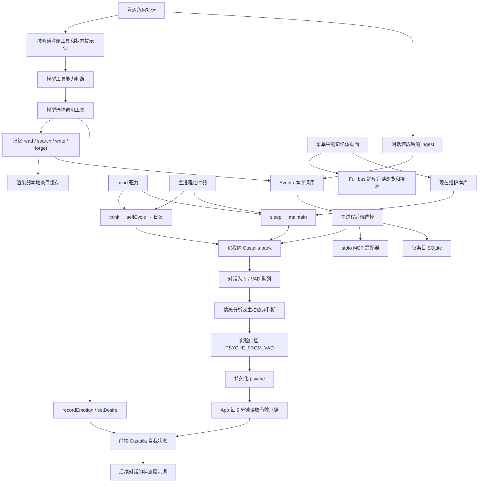

# AIRI 工具、Castalia 情感循环与记忆体链路审查报告

审查结论：**存在已复现的接线错误，也存在把失败、不可用或跳过显示成正常结果的路径。菜单显示开启，不能证明完整链路可用。**

本报告记录 15 项问题，其中 5 项为 P1，10 项为 P2。13 个隔离测试验证了部分缺陷和实验门槛。测试通过表示观察结果符合断言，不表示产品链路健康。

最需要先处理的是：

1. 第二张角色卡的保存、搜索和自动对话入库使用了不同的角色分区。
2. 保存或删除在后端失败后，工具仍能回答“已保存”或“已忘记”。
3. 后端删除明确返回 `false`，渲染器仍把条目从本地列表移除。
4. 检索故障与没有匹配结果使用相同返回值，模型据此断言“没有记忆”。
5. 完整引擎没有启用时，系统可退回仅支持条目读写的 SQLite，模块仍显示已配置。

自动情感状态不变还涉及**有意的实验限制**。估计器质量不足时，代码主动禁止它驱动 psyche。此限制不能直接归类为缺少函数调用，也不能用强行开闸代替修复。

## 审查基线与证据边界

| 项目 | 内容 |
| --- | --- |
| 仓库 | `D:\AI\castalia-AIRI` |
| 审查日期 | 2026-11-03，Asia/Shanghai |
| 分支 | `feat/tuning-manifest` |
| HEAD | `fa9bbf417779a32a8bb7782eb12b79855ea3f751` |
| 主入口 | stage-tamagotchi 的设置菜单、工具注册、Castalia 页面、长期记忆、记忆体页面 |
| 下游 | stage-ui stores/tools、Eventa、Electron 主进程、castalia-plugin、本库维护和自循环 |
| 执行环境 | Windows、Node `v24.21.0`、pnpm `11.24.0` |
| 修改范围 | 新增报告、独立审查测试和日志。没有修改受版本控制的生产源码 |

本次采用两类证据：

- **隔离实测**：调用真实适配器、临时 SQLite 库，或真实 store/tool 加模拟后端。情感模型由本机 HTTP 模拟器提供固定响应。
- **静态确认**：检查界面、调用点、事件契约和实现。此类结论说明代码条件，不声称完成界面操作。

没有启动真实 Electron 界面验证。没有读取用户实际记忆库或密钥。没有验证真实模型的调用意愿、情感识别质量或外部 MCP 服务。

P1 表示核心记忆行为错误，或成功提示与持久化事实不一致。P2 表示条件性缺线、状态误导或控制边界不一致。该分级用于修复排序。

## 实际链路

Electron 明确覆盖了共享的 Castalia 和记忆体页面，见 [路由排除配置](/D:/AI/castalia-AIRI/apps/stage-tamagotchi/electron.vite.config.ts:291)。本报告依据 Electron 实际页面。



图中的连接表示代码调用关系，不表示所有条件均已满足。角色上下文、后端能力、模型能力和实验门槛决定实际结果。

“记忆体”页面主要使用 Full bus。页面另有一个本库维护按钮，见 [页面边界](/D:/AI/castalia-AIRI/apps/stage-tamagotchi/src/renderer/pages/settings/memory/index.vue:10)。

**Full bus 搜到其他库的记忆，不代表聊天工具具备跨库检索能力。** 聊天工具调用的是本库 Eventa 链路。

### 后端能力对照

下表描述当前适配器的代码能力。它不保证模型服务或外部进程实际可用。

| 后端 | 条目列表、保存、删除 | recall / search / facts | 对话 ingest | maintain | selfCycle | psyche / 精力写回 |
| --- | --- | --- | --- | --- | --- | --- |
| 进程内 bank | 有实现 | 有实现 | 有实现 | 有实现 | 有实现 | 有实现 |
| stdio MCP | 有实现 | 有实现 | 未实现 | 未实现 | **有实现** | 未实现 |
| 本地 SQLite 回退 | 有实现 | 固定返回空结果 | 返回不可用 | 返回不可用 | 返回不可用 | psyche 返回 `null`，精力事件没有 handler |
| Full bus 页面 | 跨库只读浏览 | 独立跨库搜索 | 不接聊天入库 | 按钮另走本库 | 不接聊天循环 | 不接本库状态 |

依据：[后端选择及事件处理](/D:/AI/castalia-AIRI/apps/stage-tamagotchi/src/main/services/airi/castalia-memory.ts:294)、[SQLite 回退](/D:/AI/castalia-AIRI/apps/stage-tamagotchi/src/main/services/airi/castalia-memory.ts:351)、[stdio selfCycle](/D:/AI/castalia-AIRI/apps/stage-tamagotchi/src/main/services/airi/castalia-engine.ts:346)。

另外，stdio 的列表按 `source: 'airi'` 过滤。进程内列表包含多种来源。切换传输方式会改变列表范围，见 [stdio 列表](/D:/AI/castalia-AIRI/apps/stage-tamagotchi/src/main/services/airi/castalia-engine.ts:249)。外部 MCP 服务是否支持该调用，本次没有验证。

## 问题清单

| 编号 | 级别 | 问题 | 证据 |
| --- | --- | --- | --- |
| F01 | P1 | 角色标识未贯穿搜索、入库和循环 | 隔离实测 + 静态确认 |
| F02 | P1 | 后端拒绝删除，前端仍移除条目 | 隔离实测 + 静态确认 |
| F03 | P1 | 保存、删除工具提前报告成功 | 隔离实测 |
| F04 | P1 | 检索失败伪装成没有记忆 | 隔离实测 |
| F05 | P1 | 模块开启与完整后端可用混为一谈 | 静态确认 |
| F06 | P2 | 自动情感有独立实验门槛，界面没有反映 | 隔离实测 + 静态确认 |
| F07 | P2 | VAD 十分钟时限缺少独立触发器 | 隔离实测 + 静态确认 |
| F08 | P2 | 主动搜索遗漏共享记忆 | 隔离实测 |
| F09 | P2 | 后端新记忆不刷新前端读缓存 | 隔离实测 + 静态确认 |
| F10 | P2 | 傲娇滑块保存数值，却没有运行时行为消费者 | 隔离实测 + 静态确认 |
| F11 | P2 | 设置页和聊天使用不同的自我状态键 | 静态确认 |
| F12 | P2 | 历史记忆、情感工具调用无法重跑 | 静态确认 |
| F13 | P2 | 模型工具降级状态对用户不可见 | 静态确认 + 既有测试 |
| F14 | P2 | Castalia 开关仅控制部分链路 | 静态确认 |
| F15 | P2 | 维护因冷却跳过，界面仍显示完成 | 静态确认 |

### F01 · P1 · 角色上下文在跨层调用中丢失

**触发与表现。** 使用第二张角色卡保存事实，再通过工具搜索或继续聊天。保存可以进入该卡分区，搜索却查后端预设角色。自动保存的对话也进入预设角色。

**根因。** `withRunTools` 为 read、write、forget 绑定当前 persona。search 和 facts 只接收查询文本，见 [会话工具注册](/D:/AI/castalia-AIRI/packages/stage-ui/src/stores/chat.ts:675)。对话完成后的 ingest 只传 user、assistant 和 sessionId，见 [自动入库](/D:/AI/castalia-AIRI/packages/stage-ui/src/stores/chat.ts:1108)。

Eventa 的 recall、search、ingest、selfCycle、精力写回输入缺少角色字段。psyche 支持角色字段，但 App 传入 `{}`，见 [事件契约](/D:/AI/castalia-AIRI/apps/stage-tamagotchi/src/shared/eventa/castalia-memory.ts:30) 和 [psyche 读取](/D:/AI/castalia-AIRI/apps/stage-tamagotchi/src/renderer/App.vue:489)。

进程内适配器保存时尊重 `entry.persona`，搜索时使用 `options.character`，见 [保存](/D:/AI/castalia-AIRI/apps/stage-tamagotchi/src/main/services/airi/castalia-inprocess.ts:99) 和 [搜索](/D:/AI/castalia-AIRI/apps/stage-tamagotchi/src/main/services/airi/castalia-inprocess.ts:142)。bank 的 facts、ingest 和 selfCycle 也绑定创建句柄时的角色，见 [bank 角色绑定](/D:/AI/castalia-AIRI/packages/castalia-plugin/src/bank/index.ts:237) 和 [ingest](/D:/AI/castalia-AIRI/packages/castalia-plugin/src/bank/index.ts:291)。

**隔离结果。** `second-card` 的条目保存成功。适配器搜索返回 0 条。直接指定 `second-card` 搜索能找到同一条。无角色 ingest 则写入配置角色 `airi`。

**影响。** 同一角色的记忆读写不闭合。其他角色的事实还可能进入回答。情感证据和日记也缺少跟随当前角色的完整上下文。

**修复建议。** 统一角色解析入口。把解析后的 `project`、`characterId` 传入检索、入库、循环、状态读取和精力写回。保留角色隔离规则。

**验收。** 两张卡写入不同标记。分别检查 read、search、facts、自动入库、psyche 和日记。每个结果必须归属目标角色。

### F02 · P1 · 删除返回 false，却被当作成功处理

**触发与表现。** 删除 hydrate 后带 `id` 的第二角色条目。后端返回 `false`，本地列表仍移除它。再次 hydrate 或重启后，条目重新出现。

**根因。** 适配器有 `id` 时调用 `bank.forget(id)`。该方法使用 bank 的固定角色过滤，忽略传入条目的 persona，见 [按 ID 删除](/D:/AI/castalia-AIRI/apps/stage-tamagotchi/src/main/services/airi/castalia-inprocess.ts:111) 和 [bank.forget](/D:/AI/castalia-AIRI/packages/castalia-plugin/src/bank/index.ts:242)。

App 的包装函数等待删除调用，却丢弃 boolean 结果，见 [返回值丢失](/D:/AI/castalia-AIRI/apps/stage-tamagotchi/src/renderer/App.vue:104)。store 在后端确认前就删除本地条目，见 [本地 remove](/D:/AI/castalia-AIRI/packages/stage-ui/src/stores/memory.ts:562)。

**隔离结果。** 第二角色条目的按 ID 删除返回 `false`。再次列出临时库，持久化条目仍存在。

**影响。** 用户看到“删掉了”，实际数据没有删除。明确拒绝也不会作为异常进入失败统计。

**修复建议。** 保留删除结果及拒绝原因。仅在后端确认后报告删除成功。若采用乐观更新，失败后必须恢复本地条目。

**验收。** 覆盖正确角色删除、错误角色拒绝和派生数据拒绝。界面、工具结果和再次读取必须一致。

派生日记的通用删除保护是有意设计，见 [派生数据保护](/D:/AI/castalia-AIRI/packages/castalia-plugin/src/vendor/engine/store.ts:490)。修复不能绕过该保护。

### F03 · P1 · 保存和删除工具在持久化完成前宣布成功

**触发与表现。** 模型调用保存或忘记工具，后端随后拒绝。工具仍返回 `Saved memory` 或 `Forgot memory`。

**根因。** store 的 write 和 remove 先改本地数组，再以 `void` 启动远程操作。失败只记日志和健康状态，见 [write](/D:/AI/castalia-AIRI/packages/stage-ui/src/stores/memory.ts:528) 和 [remove](/D:/AI/castalia-AIRI/packages/stage-ui/src/stores/memory.ts:562)。工具根据本地同步返回值生成成功文本，见 [工具确认文本](/D:/AI/castalia-AIRI/packages/stage-ui/src/tools/memory.ts:161)。

**隔离结果。** 模拟后端分别抛出磁盘写入失败和离线错误。工具仍返回两条成功文本，remoteHealth 同时累计失败。

**影响。** 模型能向用户作出错误承诺。会话结束或缓存重新加载后，事实与承诺不符。

**修复建议。** 为持久化操作返回可等待的结果。工具区分已持久化、待写入和失败。不要把本地缓存更新当作落盘确认。

**验收。** 延迟、拒绝和成功三种后端结果必须产生不同状态。失败情况下不能出现最终成功文本。

F02 是明确拒绝结果丢失。F03 是异步完成状态丢失。两者必须同时处理。

### F04 · P1 · 搜索故障被翻译为“记忆里没有”

**触发与表现。** search 和 facts 服务不可用。模型收到普通的 `No memory matched`，无法区分故障与真正未命中。

**根因。** recall 捕获异常后返回空文本。search 和 facts 捕获异常后返回空数组，见 [错误折叠](/D:/AI/castalia-AIRI/packages/stage-ui/src/stores/memory.ts:587)。工具把双空结果翻译成没有匹配，见 [搜索工具](/D:/AI/castalia-AIRI/packages/stage-ui/src/tools/memory.ts:130)。提示词还明确要求把空结果理解为事实不存在，见 [空结果语义](/D:/AI/castalia-AIRI/packages/stage-ui/src/tools/memory.ts:52)。

**隔离结果。** 两个搜索端口均抛错，工具仍返回普通未命中文本。

**已有监测。** 系统不是完全没有故障提示。连续两次失败会触发 `remoteDegraded`，设置页存在提醒，见 [阈值](/D:/AI/castalia-AIRI/packages/stage-ui/src/stores/memory.ts:693) 和 [提醒](/D:/AI/castalia-AIRI/packages/stage-ui/src/composables/use-settings-needs-attention.ts:580)。但任意成功操作都会清零连续失败数，见 [成功计数](/D:/AI/castalia-AIRI/packages/stage-ui/src/stores/memory.ts:418)。返回空结果的能力缺失也不算异常。

**影响。** 故障改变了模型对事实是否存在的判断。混合成功和失败还能掩盖某一个端口持续不可用。

**修复建议。** 区分命中、未命中、能力不可用和请求失败。分别记录操作健康状态。故障时不要向模型声明记忆不存在。

**验收。** 对正常空结果、超时、无该能力和部分端口失败分别断言。工具必须保留这些差别。

### F05 · P1 · 模块显示已配置，实际只接到有限的 SQLite

**触发与表现。** Castalia 配置缺失、JSON 损坏、显式禁用或路径失效。用户仍能开启模块，但语义搜索、自动入库和情感循环没有完整后端。

**根因。** 模块列表把 `configured` 直接等同于 enabled，见 [长期记忆状态](/D:/AI/castalia-AIRI/packages/stage-ui/src/composables/use-modules-list.ts:193) 和 [Castalia 状态](/D:/AI/castalia-AIRI/packages/stage-ui/src/composables/use-modules-list.ts:202)。

配置读取失败变为空配置。解析器在配置或路径不满足条件时返回 `undefined`，见 [配置读取和解析](/D:/AI/castalia-AIRI/apps/stage-tamagotchi/src/main/services/airi/castalia-engine.ts:51)。随后主进程选择 SQLite 回退。recall、search、facts 固定返回空结果，见 [回退能力](/D:/AI/castalia-AIRI/apps/stage-tamagotchi/src/main/services/airi/castalia-memory.ts:351)。

默认进程内模式仍要求 `engineEntry` 文件存在，尽管该模式不启动此文件。这个多余前置条件也能使完整 bank 被跳过。

**影响。** “已配置”只证明布尔值已开启。用户无法从该状态判断当前后端、缺失能力或配置失败原因。

**修复建议。** 分离启用状态、配置状态和运行状态。显示当前后端及缺失能力。进程内与 stdio 分别检查实际必需的配置。

**验收。** 使用缺失配置、损坏配置、失效路径、进程内模式和 stdio 模式检查状态。每种情况必须显示真实能力。

本次没有读取实际安装的 `castalia-engine.json`。报告不判定用户当前运行的是哪一种后端。

### F06 · P2 · 自动情感另有实验门槛，模块开关没有表达这个限制

**触发与表现。** 开启 Castalia，正常聊天并成功入库，情绪面板仍长期不变。即使写入有效模型 VAD，psyche 也不一定更新。

**根因。** 自动推进 psyche 另行要求 `PSYCHE_FROM_VAD=on`，见 [模型通道门槛](/D:/AI/castalia-AIRI/packages/castalia-plugin/src/vendor/engine/emotion.ts:1170)。页面开关没有设置该变量，[参数清单](/D:/AI/castalia-AIRI/packages/castalia-plugin/src/tuning.ts) 也没有暴露它。

这是有意的实验限制。源码明确记录两个估计器没有通过质量门槛，见 [默认关闭原因](/D:/AI/castalia-AIRI/packages/castalia-plugin/src/vendor/engine/emotion.ts:1130)。本地词表还会主动清空 valence、dominance，写入 `affect_status='abstain'`，不生成待推进证据，见 [本地放弃判断](/D:/AI/castalia-AIRI/packages/castalia-plugin/src/vendor/engine/emotion.ts:750)。因此，单独打开环境变量也不能让本地词表推进 psyche。

App 每五分钟读取一次 psyche，而且只有 `hasEvidence` 为真才镜像到前端，见 [镜像条件](/D:/AI/castalia-AIRI/apps/stage-tamagotchi/src/renderer/App.vue:489)。

**隔离结果。** 四组实验结果如下。模型响应来自本机模拟器。

| 分析来源 | 实验门槛 | 记忆分析状态 | psyche 获得证据 |
| --- | --- | --- | --- |
| 本地词表 | 未开启 | `abstain` | 否 |
| 本地词表 | `on` | `abstain` | 否 |
| 有效模型响应 | 未开启 | `analyzed` | 否 |
| 同一模型响应 | `on` | `analyzed` | 是 |

**影响。** 用户把“模块启用”理解为“自动情感已运行”，实际还存在独立门槛和证据条件。当前界面不能解释状态为什么没有变化。

**修复建议。** 显示自动情感能力、实验门槛、最近分析来源和未推进原因。保留质量门槛，不用强行开启估计器代替状态说明。

**验收。** 覆盖以上四种组合，分别显示已分析、主动放弃判断、实验关闭和已推进。真实模型质量必须单独评估。

### F07 · P2 · 十分钟队列年龄没有独立的到期触发器

**触发与表现。** 少量对话进入 VAD 队列后，用户停止聊天。十分钟过去，队列仍没有自动处理。

**根因。** 配置是最多 15 条、最少批量 5 条、最大年龄十分钟，见 [队列配置](/D:/AI/castalia-AIRI/packages/castalia-plugin/src/vendor/engine/emotion.ts:531)。入队函数只有达到 15 条才主动 flush，没有注册年龄定时器，见 [入队触发](/D:/AI/castalia-AIRI/packages/castalia-plugin/src/vendor/engine/emotion.ts:679)。年龄条件只在已经调用 flush 后检查，见 [年龄判断](/D:/AI/castalia-AIRI/packages/castalia-plugin/src/vendor/engine/emotion.ts:1021)。

bank 在 `MEMORY_AUTO_PROCESS=1` 的 ingest 分支额外调用非强制 flush，见 [入库后的检查](/D:/AI/castalia-AIRI/packages/castalia-plugin/src/bank/index.ts:307)。最小入库分支没有这次额外检查。两者都没有建立十分钟到期触发器。嵌入模式也没有通过 `maybeDigest` 建立一个持续检查队列年龄的独立时钟。

**隔离结果。** 一条对话入队，调用非强制 flush 后仍待处理。推进模拟时钟十一分钟，队列仍有一条，最老年龄至少 660 秒。

**影响。** 十分钟实际上是“下次检查时可以处理”的条件，不是处理时限。少量对话的情感更新取决于后续操作。

**修复建议。** 明确队列调度责任。增加到期检查或与现有调度器连接，并显示待处理数和最老年龄。

**验收。** 一条记录入队后，不再进行对话或手动操作。在定义的时限内，系统必须自动处理，或显示明确的等待条件。

这不表示记录永远不处理。后续入库、启动后的维护补偿或夜间维护都能成为其他触发来源。

### F08 · P2 · 主动搜索没有包含共享记忆

**触发与表现。** 共享条目出现在列表和角色索引中，按同一标记主动搜索却返回空结果。

**根因。** 进程内 search 传入固定角色，却没有传 `includeGeneral: true`，见 [适配器搜索参数](/D:/AI/castalia-AIRI/apps/stage-tamagotchi/src/main/services/airi/castalia-inprocess.ts:142)。引擎默认不包含无主共享条目，这个默认值用于维护隔离，见 [选项契约](/D:/AI/castalia-AIRI/packages/castalia-plugin/src/vendor/engine/search.ts:91)。

**隔离结果。** 共享条目在 list 中可见，adapter search 返回 0 条。直接调用 bank.search，并显式开启 `includeGeneral`，即可找到同一条。

**影响。** read、索引与主动 search 的可见范围不一致。用户已经看见的共享记忆，搜索端口仍能报告没有匹配。

**修复建议。** 在面向用户的检索适配器中显式包含共享条目。维护函数继续使用严格角色隔离。

**验收。** 当前角色条目和共享条目都能被主动检索。其他角色的私有条目仍不可见。维护操作不能跨角色修改数据。

本项实测针对普通 search 端口，不表示所有记忆来源和所有查询都会被完整工具漏掉。

### F09 · P2 · 后端生成的记忆不刷新前端读取缓存

**触发与表现。** 后端入库或维护生成新条目，搜索能找到，read 和提示词索引仍看不到。重新 hydrate 后才出现。

**根因。** Electron App 启动时调用一次 `memoryStore.hydrate()`，见 [启动加载](/D:/AI/castalia-AIRI/apps/stage-tamagotchi/src/renderer/App.vue:113)。自动 ingest 和维护完成后没有刷新该缓存，也没有后端变更事件更新它。

进程内列表还固定最多读取 2000 条，见 [列表上限](/D:/AI/castalia-AIRI/apps/stage-tamagotchi/src/main/services/airi/castalia-inprocess.ts:78)。该列表跨角色且包含多种来源，见 [列表范围](/D:/AI/castalia-AIRI/packages/castalia-plugin/src/bank/index.ts:244)。它不是完整持久库的实时视图。

**隔离结果。** hydrate 空列表后，模拟后端新增一条事实。search 返回该事实，read 为 `undefined`，index 不含条目名。再次 hydrate 后 read 正常。

**影响。** 搜索与读取看到不同时间的数据。条目很多时，重新 hydrate 也不能保证缓存包含目标记录。

**修复建议。** 为后端变更建立缓存更新机制。按 ID 或名称读取时支持直接访问持久库，并明确列表分页边界。

**验收。** 自动入库和维护生成条目后，不重启即可读取。再验证超过 2000 条以及多角色混合列表。

原始 transcript 从索引隐藏、派生日记默认不参与普通搜索，属于单独的可见性规则，不是本项缓存缺陷。

### F10 · P2 · 傲娇滑块只有数值保存，没有运行时行为消费者

**触发与表现。** 把傲娇程度从 0 调到 10，页面数值变化，后续状态提示词保持相同。

**根因。** 页面调用 `setTsundereLevel`，见 [滑块绑定](/D:/AI/castalia-AIRI/apps/stage-tamagotchi/src/renderer/pages/settings/modules/castalia.vue:155)。store 保存数值，snapshot 也包含该字段，见 [数值保存](/D:/AI/castalia-AIRI/packages/castalia-plugin/src/store.ts:128) 和 [snapshot](/D:/AI/castalia-AIRI/packages/castalia-plugin/src/store.ts:53)。但实际提示词没有读取它，见 [提示词生成](/D:/AI/castalia-AIRI/packages/castalia-plugin/src/agent-state.ts:103)。

`decayEmotion` 支持这个参数，但本次检索只找到定义和测试调用，见 [衰减函数](/D:/AI/castalia-AIRI/packages/castalia-plugin/src/emotion.ts:36)。引擎分析得到的 tsundere 值来自另一条路径，不能证明页面滑块已经接入运行时。

**隔离结果。** 用真实 store 和提示词格式化器，将数值从 0 改成 10。snapshot 已更新，提示词逐字相同。正对照调用 `recordEmotion` 后，提示词发生变化。

**影响。** 这是本次最明确的“控件能动，行为不变”路径之一。

**修复建议。** 明确该数值要控制的行为并接入消费者。若尚未实现，标明状态或移除可操作控件。

**验收。** 除保存值以外，断言其目标行为发生可解释的变化。不能用 snapshot 数值更新证明功能生效。

### F11 · P2 · 设置页和聊天没有统一解析角色状态键

**触发与表现。** 默认角色打开 Castalia 设置时，页面切换到 `default` 状态。聊天则能使用 `airi` 状态。面板与聊天读到两份自我状态。

**根因。** 设置页的 immediate watcher 直接使用原始 `activeCardId`，见 [页面角色切换](/D:/AI/castalia-AIRI/apps/stage-tamagotchi/src/renderer/pages/settings/modules/castalia.vue:23)。聊天在长期记忆开启时先执行 `resolvePersona`，再切换 Castalia 角色，见 [聊天角色解析](/D:/AI/castalia-AIRI/packages/stage-ui/src/stores/chat.ts:334)。

默认别名通常把 `default` 映射为 `airi`。但如果缓存中已有原始 `default` 分区，解析器优先保留它，见 [别名规则](/D:/AI/castalia-AIRI/packages/stage-ui/src/stores/memory.ts:491)。因此，问题也受已有数据和 hydrate 状态影响。

mind 初始化和角色切换使用原始卡 ID，见 [mind 的角色键](/D:/AI/castalia-AIRI/apps/stage-tamagotchi/src/renderer/App.vue:468)。精力镜像又通过未显式传角色的 `setEnergy` 写入当前 Castalia 分区，见 [精力写入](/D:/AI/castalia-AIRI/apps/stage-tamagotchi/src/renderer/App.vue:529)。

**影响。** 页面动作和调用顺序能改变活动状态分区。默认卡尤其容易出现“设置已经改了，聊天没有读到”的现象。

**证据边界。** 本项由调用点和状态键规则静态确认，没有操作真实界面。

**修复建议。** 页面、聊天、mind 和后端统一获取同一角色上下文。状态写入显式传角色，避免依赖全局当前值。

**验收。** 覆盖首次启动、hydrate 前后、打开设置、关闭设置和切卡。面板、工具与提示词必须持续指向同一角色。

### F12 · P2 · 历史记忆和情感工具重跑缺少会话工具注册

**触发与表现。** 用户重跑历史中的记忆或情感工具调用。普通聊天时可用的工具，在重跑路径中找不到。

**根因。** 这些工具由 `withRunTools` 按会话动态注册，见 [普通对话注册](/D:/AI/castalia-AIRI/packages/stage-ui/src/stores/chat.ts:675)。重跑只从全局 `llmToolsStore` 取工具，没有经过这个注册入口，见 [重跑解析](/D:/AI/castalia-AIRI/packages/stage-ui/src/stores/chat.ts:1521)。

找不到工具时，重跑函数会用不可用错误替换已有结果，见 [结果替换](/D:/AI/castalia-AIRI/packages/stage-ui/src/stores/tool-call-rerun.ts:169)。

**影响。** 用户尝试重跑一次历史调用，会得到工具不可用，并失去该位置原先的成功结果文本。

**证据边界。** 本项为静态调用链确认。已有通用 rerun 测试通过，但不覆盖上述会话注册遗漏。

**修复建议。** 按原会话角色解析动态工具。若某类调用不支持重跑，在入口说明，并保留原结果。

**验收。** 对当前卡和非当前卡的历史记忆、情感调用分别重跑。工具必须使用原会话角色。不可用时不能覆盖原成功结果。

### F13 · P2 · 模型明确不支持工具后，后续工具被静默省略

**触发与表现。** 模型或服务首次返回明确的“不支持工具”错误。当前请求失败，后续同模型请求继续聊天，但不再携带这些工具。

**根因。** LLM store 将兼容状态记录在私有 Map，见 [兼容状态](/D:/AI/castalia-AIRI/packages/stage-ui/src/stores/ai/chat-llm/llm.ts:41)。遇到匹配错误时设置为 `false`，随后仍抛出原异常，见 [降级记录](/D:/AI/castalia-AIRI/packages/stage-ui/src/stores/ai/chat-llm/llm.ts:107)。后续调用据此省略工具，直到该 store 重建。

该机制只匹配明确的不支持错误。普通工具执行失败和单个 schema 错误不在规则中，见 [错误匹配范围](/D:/AI/castalia-AIRI/packages/core-agent/src/runtime/llm-service.ts:328)。已有测试覆盖模型隔离和 schema 错误边界。

**影响。** 模块仍显示启用，实际当前模型已经不接收工具。用户更换服务配置后，也没有清晰的能力重探测状态。

**修复建议。** 显示当前模型的实际工具能力和最近禁用原因。提供明确的重新探测入口，并定义配置变更后的失效规则。

**验收。** 明确不支持错误必须产生可见状态。不同模型互不影响。服务恢复后能重新探测。单个 schema 错误不能禁用全部工具。

自动降级有合理用途。缺陷在于这个状态没有进入模块可用性判断，也没有清晰的恢复路径。

### F14 · P2 · Castalia 开关没有覆盖整个后台循环生命周期

**触发与表现。** 关闭 Castalia 后，聊天不再提供情感工具，但后台状态同步、精力写回或维护仍能继续。

**根因。** 聊天工具注册和状态提示词检查 enabled，见 [工具开关](/D:/AI/castalia-AIRI/packages/stage-ui/src/stores/chat.ts:685) 和 [提示词开关](/D:/AI/castalia-AIRI/packages/stage-ui/src/stores/chat.ts:1048)。主动说话也检查它，见 [主动说话条件](/D:/AI/castalia-AIRI/packages/stage-ui/src/stores/modules/self-initiated-speech.ts:104)。

但 App 的 psyche 轮询、think→selfCycle、精力镜像和 sleep→maintain 没有这个条件，见 [后台接线](/D:/AI/castalia-AIRI/apps/stage-tamagotchi/src/renderer/App.vue:489)。mind 的 think、sleep 决策也不检查 Castalia enabled，见 [驱力决策](/D:/AI/castalia-AIRI/packages/stage-ui/src/stores/modules/mind.ts:744)。主进程维护和自循环定时器另行启动，见 [主进程调度](/D:/AI/castalia-AIRI/apps/stage-tamagotchi/src/main/services/airi/castalia-memory.ts:342)。

**影响。** 关闭模块只停止部分功能，不能据此判断后台是否停止。部分失败或跳过还被折叠为 `undefined`，界面难以解释未执行原因。

**证据边界。** 本项为静态生命周期检查，没有验证真实 Electron 的定时行为。

**修复建议。** 明确“聊天状态和工具”与“后台自动循环”的控制范围。若保留一个总开关，所有相关调度必须遵守同一状态。

**验收。** 开启、关闭和再次开启时，检查工具、提示词、轮询、think、sleep 维护和主进程定时器。执行状态必须符合界面说明。

这不是开关完全失效。已经存在的 enabled 检查确实控制了聊天侧功能。

### F15 · P2 · 手动维护因冷却跳过，页面仍能显示完成

**触发与表现。** 上一次维护成功且配置了 LLM。在冷却期内点击“现在维护”，页面显示完成，并复用上一次的事实数或合并数。

**根因。** 维护队列使用成功后 20 小时、失败后 30 分钟的冷却，见 [冷却配置](/D:/AI/castalia-AIRI/apps/stage-tamagotchi/src/main/services/airi/castalia-memory.ts:74)。冷却内返回旧 report，加上 `skipped=true`、跳过原因和 `ms=0`，见 [跳过返回](/D:/AI/castalia-AIRI/apps/stage-tamagotchi/src/main/services/airi/castalia-memory.ts:130)。

页面没有检查 `skipped`。旧 report 成功且 `reflectConfigured` 为真时，直接进入完成分支，见 [页面状态判断](/D:/AI/castalia-AIRI/apps/stage-tamagotchi/src/renderer/pages/settings/memory/index.vue:30)。

**影响。** “本次执行完成”与“本次没有执行”混在一起。旧计数被当作本次产出，用户不能判断按钮是否真的触发维护。

**证据边界。** 本项为静态分支确认，没有点击真实界面的维护按钮。

**修复建议。** 优先处理 skipped，显示原因、上次执行结果和下次可运行时间。无需为了按钮有反应而盲目绕过冷却。

**验收。** 分别覆盖首次执行、成功冷却、失败冷却和未配置 LLM。每种状态必须有准确说明，不能复用旧计数冒充本次结果。

未配置 LLM 已有明确提示，见 [无模型提示](/D:/AI/castalia-AIRI/apps/stage-tamagotchi/src/renderer/pages/settings/memory/index.vue:39)。问题只在跳过状态没有处理。

## 已接通的链路与有意限制

本次没有发现整套模块都是空壳。下表列出已存在的实现，防止把所有“无变化”都归入接线遗漏。

| 链路或现象 | 审查结论 |
| --- | --- |
| 普通会话工具 | 携带请求关联信息的聊天会注册四个记忆工具和两个情感工具。开关、模型能力与模型选择决定是否调用。开启不等于每轮必调 |
| `recordEmotion`、`setDesire` | 确实写入前端角色状态，并影响后续回合提示词。当前模型请求已经发出，下一回合读取新状态符合现有设计 |
| 工具情感与引擎 psyche | 两者是不同来源。引擎有证据后，五分钟镜像能覆盖工具写入的临时 VAD。不能把两个数值简单看作同一条来源 |
| selfCycle | 有实际日记写入、运行中保护、持久化证据认领、游标与水位恢复。没有证据支持“每次都重复生成同一篇日记”的结论 |
| 日记内容 | 当前 `formatDiary` 是确定性模板。日记存在不证明执行了 LLM 自主思考 |
| 派生日记删除 | 通用删除保护是有意策略。修复删除结果时必须保留保护 |
| 共享记忆写入 | 普通聊天禁止修改、删除共享条目，属于现有权限策略 |
| transcript 和 diary 可见性 | transcript 不进入普通索引、diary 默认不进入普通搜索，属于证据边界策略 |
| reflect 无 LLM | reflect 依赖模型，界面有提示。只完成 digest 的维护结果有明确实现，不能直接认定整次维护没有运行 |
| 记忆体 Full bus | 页面有错误和离线处理。它独立于聊天本库检索，不属于所有路径都假成功 |
| stdio 自循环 | stdio 适配器有 selfCycle。只有主进程的周期自循环定时器限定进程内模式 |

关键依据：[会话工具注册](/D:/AI/castalia-AIRI/packages/stage-ui/src/stores/chat.ts:675)、[持久化证据认领](/D:/AI/castalia-AIRI/packages/castalia-plugin/src/vendor/engine/selfCycle.ts:85)、[游标恢复](/D:/AI/castalia-AIRI/packages/castalia-plugin/src/vendor/engine/selfCycle.ts:220)、[日记模板](/D:/AI/castalia-AIRI/packages/castalia-plugin/src/vendor/engine/selfCycle.ts:285)、[Full bus 状态处理](/D:/AI/castalia-AIRI/apps/stage-tamagotchi/src/renderer/pages/settings/memory/index.vue:88)。

## 复现证据

独立配置：[vitest.config.ts](/D:/AI/castalia-AIRI/docs-notes/audits/castalia-tools-memory-2026-11-03/vitest.config.ts)。两个审查文件使用 Node 环境串行执行，不混入原测试配置。

| 复现 | 对应问题 | 代码 |
| --- | --- | --- |
| 第二卡保存后搜索为 0，指定角色后命中 | F01 | [临时库测试](/D:/AI/castalia-AIRI/packages/castalia-plugin/audits/castalia-wiring-2026-11-03.test.ts:92) |
| hydrated 第二卡 ID 删除返回 false，条目保留 | F02 | [删除测试](/D:/AI/castalia-AIRI/packages/castalia-plugin/audits/castalia-wiring-2026-11-03.test.ts:102) |
| 共享条目可列出，默认 search 漏掉 | F08 | [共享检索测试](/D:/AI/castalia-AIRI/packages/castalia-plugin/audits/castalia-wiring-2026-11-03.test.ts:110) |
| 无角色 ingest 写入固定配置角色 | F01 | [入库测试](/D:/AI/castalia-AIRI/packages/castalia-plugin/audits/castalia-wiring-2026-11-03.test.ts:121) |
| 十一分钟没有新的调用，队列仍待处理 | F07 | [队列测试](/D:/AI/castalia-AIRI/packages/castalia-plugin/audits/castalia-wiring-2026-11-03.test.ts:129) |
| 本地词表，实验关闭，不产生 psyche 证据 | F06 | [本地关闭测试](/D:/AI/castalia-AIRI/packages/castalia-plugin/audits/castalia-wiring-2026-11-03.test.ts:146) |
| 本地词表，实验开启，仍不产生 psyche 证据 | F06 | [本地开启测试](/D:/AI/castalia-AIRI/packages/castalia-plugin/audits/castalia-wiring-2026-11-03.test.ts:159) |
| 有效模型响应，实验关闭，只写分析结果 | F06 | [模型关闭测试](/D:/AI/castalia-AIRI/packages/castalia-plugin/audits/castalia-wiring-2026-11-03.test.ts:170) |
| 同一模型响应，实验开启，推进 psyche | F06 | [模型开启测试](/D:/AI/castalia-AIRI/packages/castalia-plugin/audits/castalia-wiring-2026-11-03.test.ts:183) |
| 后端保存和删除拒绝，工具仍返回成功 | F03 | [持久化确认测试](/D:/AI/castalia-AIRI/packages/stage-ui/audits/castalia-wiring-2026-11-03.test.ts:32) |
| 两个搜索端口拒绝，工具返回普通未命中 | F04 | [检索故障测试](/D:/AI/castalia-AIRI/packages/stage-ui/audits/castalia-wiring-2026-11-03.test.ts:60) |
| 后端新增事实，search 可见，read/index 不见 | F09 | [缓存测试](/D:/AI/castalia-AIRI/packages/stage-ui/audits/castalia-wiring-2026-11-03.test.ts:83) |
| 滑块 0→10，实际提示词不变，情感工具正对照有效 | F10 | [滑块测试](/D:/AI/castalia-AIRI/packages/stage-ui/audits/castalia-wiring-2026-11-03.test.ts:103) |

临时库测试关闭 embedding，使用不存在的 key 文件路径，并把模型端点指向 loopback 模拟器。模拟器提供固定 VAD，或返回 503 触发本地放弃判断路径。

这组测试只证明指定输入下的接线行为。它不证明真实模型能识别情感，也不证明真实 Electron 的跨窗口和进程生命周期正常。

## 已执行检查

所有命令从仓库根目录执行。下表给出实际结果，不把仓库既有错误计为本次修复，也不宣称全仓检查通过。

| 命令 | 结果 | 日志 |
| --- | --- | --- |
| `pnpm exec vitest run --config docs-notes/audits/castalia-tools-memory-2026-11-03/vitest.config.ts --reporter verbose` | 退出 0。2 文件、13 测试通过 | [审查日志](/D:/AI/castalia-AIRI/docs-notes/audits/castalia-tools-memory-2026-11-03/logs/wiring-audit-final.log) |
| `pnpm -F @proj-airi/castalia-plugin test`，首次隔离运行 | 退出 1。101 通过、1 失败。宿主 PSYCHE 参数影响基准断言 | [首次插件日志](/D:/AI/castalia-AIRI/docs-notes/audits/castalia-tools-memory-2026-11-03/logs/castalia-tests.log) |
| `pnpm -F @proj-airi/castalia-plugin test`，清除三个继承参数后 | 退出 0。14 文件、102 测试通过 | [插件复核日志](/D:/AI/castalia-AIRI/docs-notes/audits/castalia-tools-memory-2026-11-03/logs/castalia-tests-clean-env.log) |
| 下方 stage-ui 定向命令 | 退出 0。11 文件、181 测试通过 | [stage-ui 日志](/D:/AI/castalia-AIRI/docs-notes/audits/castalia-tools-memory-2026-11-03/logs/stage-ui-tests.log) |
| `pnpm exec eslint docs-notes/audits/castalia-tools-memory-2026-11-03/vitest.config.ts packages/stage-ui/audits/castalia-wiring-2026-11-03.test.ts packages/castalia-plugin/audits/castalia-wiring-2026-11-03.test.ts` | 退出 0。新增审查文件通过 | 终端输出为空，无单独日志 |
| `pnpm -F @proj-airi/castalia-plugin typecheck` | 退出 2。既有测试有 1 条类型诊断 | [插件类型日志](/D:/AI/castalia-AIRI/docs-notes/audits/castalia-tools-memory-2026-11-03/logs/castalia-typecheck.log) |
| `pnpm -F @proj-airi/stage-ui typecheck` | 退出 2。113 条 TypeScript 诊断 | [stage-ui 类型日志](/D:/AI/castalia-AIRI/docs-notes/audits/castalia-tools-memory-2026-11-03/logs/stage-ui-typecheck.log) |
| `pnpm lint` | 未通过。603 errors、458 warnings，共 1061 项。进程还异常退出 | [全仓 lint 日志](/D:/AI/castalia-AIRI/docs-notes/audits/castalia-tools-memory-2026-11-03/logs/lint-final.log) |

stage-ui 定向命令：

```powershell
pnpm -F @proj-airi/stage-ui exec vitest run --project node src/stores/memory.test.ts src/stores/memory.remote.test.ts src/stores/castalia-path.test.ts src/tools/memory.test.ts src/tools/castalia.test.ts src/stores/chat.contract.test.ts src/stores/chat/context-providers/memory-recall.test.ts src/stores/modules/mind.integration.test.ts src/stores/ai/chat-llm/llm.test.ts src/stores/ai/chat-llm/tool-resolver.test.ts src/stores/tool-call-rerun.test.ts
```

插件第一次失败时继承了以下宿主参数：`PSYCHE_BAND_HOLD=0.08`、`PSYCHE_BAND_ENTER=0.18`、`PSYCHE_BAND_CENTER_OFFSET=-0.2`。清除这三个变量后，原套件全部通过。两次均使用隔离库、关闭 embedding、不可用的 key 文件路径和本机模拟端点。

本次 shell 没有 `PSYCHE_FROM_VAD`。这不是实际 Electron 进程环境的证据。

类型检查的主要限制：

- castalia-plugin：`src/psyche-layered.test.ts:227` 的 `valenceBias` 是 `number | undefined`，与要求的 `number` 不兼容。
- stage-ui：包含缺失模块、已不存在的 provider 方法，以及 `airi-card.ts:174`、`:906` 的重复实现。
- 没有类型诊断指向新增审查文件。审查文件使用独立 Vitest 配置实际执行，并单独通过 ESLint。

全仓 lint 涉及生产文件及工作区原有 probe 文件。工具返回 `-1073741819`，pnpm 记录退出码 `3221225477`。本报告不推测异常退出原因。

没有执行全仓所有测试、root typecheck、Electron 构建或真实浏览器端到端测试。报告不声称这些检查通过。

## 建议修复顺序与后续验收

1. **先修持久化确认和错误语义：F02、F03、F04。** 保证“已保存”“已删除”“没有记忆”与后端事实一致。
2. **统一角色上下文：F01、F11。** 让当前卡贯穿 read、search、facts、ingest、psyche、日记和精力写回。
3. **显示真实能力：F05、F06、F13。** 分开显示模块启用、后端能力、模型工具能力和自动情感实验状态。
4. **补齐运行中的一致性：F07、F08、F09、F10。** 处理队列到期、共享检索、缓存更新和滑块行为。
5. **补齐生命周期与操作反馈：F12、F14、F15。** 校正重跑、开关范围和维护跳过状态。

建议用一条真实 Electron 验收流程收尾：

1. 使用独立测试配置和空白测试库启动 Electron。
2. 确认界面显示实际后端、项目和角色，以及各项能力。
3. 创建两张角色卡，分别保存带唯一标记的事实。
4. 在各卡执行 read、search、forget，再重启核对持久化结果。
5. 模拟后端断开和写入拒绝，核对工具回复与故障状态。
6. 使用受控模型服务完成对话入库，观察队列、分析状态、实验门槛和 psyche 镜像。
7. 关闭与开启模块，核对所有后台调用的实际执行范围。
8. 重跑历史工具，连续点击维护，核对重跑角色、冷却提示和本次计数。
9. 单独验证 Full bus 与本库，避免用跨库页面结果代替聊天链路验收。

真实模型的调用意愿、识别质量，实际安装配置，外部 MCP 和 Full bus 联调仍未验证。上述内容属于后续验收，不是本次完成项。

## 交付范围

本次新增本报告、独立 Vitest 配置、两个审查测试文件和检查日志。没有修改生产源码，没有提交、推送或发布。

工作区原有的 `calm-probe.ts`、`maintain-probe.ts`、`selfcycle-probe.ts`、`vad-compare.ts`、`vad-coverage.ts`、`vad-flush-probe.ts` 均保留。它们不是本报告的复现证据。
