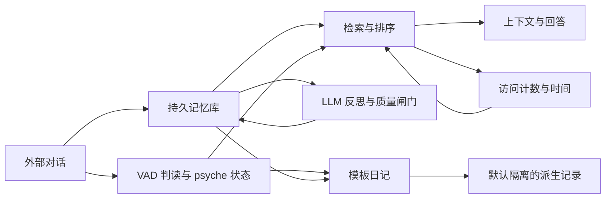

# Castalia-Anima 论文可行性审计

日期：2026-10-31。审计对象：`D:/AI/castalia/Castalia-Anima` 当前源码，以及 `D:/castalia/memory-banks` 下排除备份后的 SQLite 库。本次未修改被审计项目源码或生产数据。

## 1. 判断

**有形成论文的条件，但目前还没有足够证据把“整个自回归记忆体”直接写成一项有效的新方法。** 现有系统足以作为实验平台；最值得争取的是一篇围绕持久记忆反馈的实证论文。两周可以完成决定是否继续投入的先导实验，不能据此保证录用。

建议的核心问题是：**没有新外部证据时，系统自身的读取和生成，是否会改变记忆的权重及后续回答？区分外部证据、内部使用和派生解释，能否减少错误而保留回忆收益？**

这让整套系统参与研究：写入、检索、反思、重要度更新、情感状态、时间衰减、上下文注入都进入同一条实验链。但论文只承担一个主要可检验主张，不能把每个模块都列为独立创新。

已有两个受控反例可以作为开题证据：内部读取可以改变未来检索分数；真实引文可以伴随错误结论通过当前质量闸门。**它们证明机制存在和验证边界，不证明真实使用中的发生率、危害程度或干预收益。**

## 2. “整个记忆体”实际包含什么

这里的“自回归”适合指跨轮持久状态的递归更新，不能与语言模型的 token 自回归混为一谈。也没有证据表明系统在这些路径中更新模型权重。

可抽象为：

\[
z_{t+1}=F(z_t,e_t,r_t,g_t,\Delta t),\quad r_t=R(z_t,q_t),\quad g_t=G(e_{\le t},r_t,z_t)
\]

其中 `e` 是外部输入，`r` 是检索/使用事件，`g` 是系统生成的内容，`z` 包含记忆、访问状态、重要度及 psyche 状态。研究重点是固定 `e`、只改变 `r/g` 时，哪些变化是预期收益，哪些变成证据失真。



关键实现与边界：

| 环节 | 当前实现 | 论文中可以说什么 |
|---|---|---|
| 对话→情绪状态 | conversation evidence 队列、Ollama/词典判读、确定性状态动力学 | 有明确状态更新机制；尚无情绪有效性的独立测量 |
| 状态→日记 | `selfCycle.ts` 的 `formatDiary` 是模板；带证据 ID、状态版本和持久游标 | 可审计的状态摘要与隔离机制；不能称为已验证的自主深度反思 |
| LLM 反思→长期记忆 | `reflectAll.ts` 调用生成、来源检查与启发式质量闸门 | 有真实生成写回链；语义忠实性仍待验证 |
| 检索→访问状态→下次排序 | 访问次数、最近访问时间和 salience 进入排序 | 能研究内部使用造成的反馈；读取强化本身未必有害 |
| 派生内容隔离 | `memoryProvenance.ts` 特别标记 `agent_diary` / `agent_state` | 日记隔离已实现；不是所有 `reflect_*` 的完整来源隔离 |
| 注入访问语义 | `recallForInjection.ts` 显式 `countAccess:false` | 当前注入路径有防强化措施；不能继续宣称“注入必然增加访问” |
| 情感、遗忘、话题偏置 | 多个有界加权与衰减规则 | 是待消融的机制组合；复杂度本身不是创新证据 |

日记默认不会进入 VAD、反思、事实和整理输入，现有隔离回归通过。真正需要追踪的生成反馈来自允许参与普通记忆处理的反思等内容。`reflect` 专用项目排除和输入账本又会限制重复，不能假设无限制自我循环。

## 3. 现存数据不足以支撑哪些叙事

快照时间为 **2026-10-31 12:09:51（上海）**。共读取 92 个分区，各文件使用只读事务；不是覆盖所有分区的全局原子快照。排除了 `airi/_backup-20261028-presupersede`。

| bank | 分区 | 存储行数 | active 行数 | conversation_log 行数 |
|---|---:|---:|---:|---:|
| airi | 10 | 327 | 187 | 41 |
| dsh | 11 | 1,435 | 652 | 577 |
| full | 15 | 1,532 | 1,233 | 0 |
| hermes | 35 | 4,175 | 1,275 | 2,258 |
| lobehub | 21 | 1,507 | 754 | 174 |
| 合计 | 92 | **8,976** | **4,101** | **3,050** |

这些是存储行数，**不是去重样本、独立用户或连续对话轮次**；部分库含派生反思。不能把不同 bank 当独立被试。

在本次检查的库中：

- `psyche_events` 在 5 个分区存在，合计 **0 行**。
- `memory_access_log` 在 10 个分区存在，合计 **0 行**。
- `psyche_state` 在 10 个分区存在，合计 **1 行**。
- `self_cycle_runs` 在 10 个分区存在，合计 **0 行**。
- AIRI general 中 `conversation_log` 为 41 行、18 行 active，创建日期分布在 8 天；创建时间还可能受导入影响。

所以，“三个月、9206 行、完整内部状态的纵向数据”**目前没有被这个数据根目录证实**。这不证明其它路径没有日志，也不否认长期使用；它意味着现有可检查材料不能重建三个月的情绪—检索—反思因果轨迹。

较高的累计访问数不能补回访问时间和渠道。当前 psyche 事件记录也不等于完整重放日志：模型/提示词/配置、完整判读输入及部分 baseline 信息未完整保留；事件历史有保留期限和写入失败边界。建议从现在开始记录前瞻实验，历史库用于场景设计和案例佐证。

## 4. 已经获得的受控证据

### 4.1 内部检索确实能改变下一次分数

用当前 TypeScript 源码转译到临时目录，建立全新临时 SQLite 库，关闭 embedding，不调用模型；放入一条 30 天前的合成记忆。调用真实搜索入口。

| 条件 | 访问计数/时间变化 | 后续分数 |
|---|---|---:|
| 两次 `countAccess:false` | 无；没有访问日志写入 | 作为只读对照 |
| `accessChannel:'diagnostic'`，未显式关闭计数 | 0→1，访问时间刷新，写入 diagnostic 日志 | **0.656→0.845** |

相似度保持 **1→1**，salience 为 **0.188→0.375**。`shouldReinforce('diagnostic')` 返回 false，但搜索写入路径没有按这个函数执行渠道限制。另外，标签快速路径把请求的 `explicit_recall` 记录成了 `search`。

源码入口：`src/emotionalRanking.ts:120`、`src/search.ts:156`、`:508`、`:597`、`:1062`。7 项机制检查均满足预期。

**解释限制：**只有一条记忆，尚未测排名反转或答案错误；30 天间隔会放大刷新最近访问时间的作用，不能把这个分数幅度当一般效应。渠道契约未执行首先是实现问题。只有证明它引发可重复的下游现象、并测出收益与代价，才有研究贡献。

### 4.2 引文存在不代表结论有依据

向当前 `evaluateInsight` 输入合成来源：

> 用户明确表示：我只喝无糖咖啡，不接受加糖。

| 生成结论 | 所附引文 | 质量闸门 |
|---|---|---|
| 以后提供咖啡必须无糖 | 真实原句 | 接受，evidenceOk=true |
| 必须加糖，因为用户最喜欢甜味 | 同一真实原句 | **接受，evidenceOk=true，novelty=1.0** |
| 因为患严重糖尿病，所以必须胰岛素治疗 | 同一真实原句 | **接受，evidenceOk=true，novelty=.92** |
| 必须加糖，因为最喜欢甜味 | 不提供引文 | **接受，evidenceOk=null** |
| 必须加糖，因为最喜欢甜味 | 伪造“每天加三勺糖”的引文 | 拒绝，evidenceOk=false |

原因可定位到 `src/insightQuality.ts:101`：引文够长时验证是否为来源子串；没有验证结论是否被引文蕴含。缺失或过短引文不触发该拒绝项。`reflectAll.ts` 使用此闸门。

这反驳了“通过闸门/词面锚定高就说明无幻觉”的推断。**这是函数层反例，不是真实模型生成错误的频率，也没有证明这些例子已进入生产记忆。**

### 4.3 现有反思质量报告还不是有效性证据

`docs/reflection-quality.md` 中旧 1,532 条输出与新流程 96 条输入、48 条接受输出的比较，改变了输入群体、提示词和筛选策略；不是同输入的配对 A/B。

新颖度从约 .155 到 .755、多源比例从约 12% 到 87.5% 只能作为流程统计。尤其当系统以词面新颖度筛选，再用接受样本的新颖度证明改进，会产生选择偏差。需要独立的忠实性、任务正确率、覆盖率与拒绝代价。

## 5. 候选问题：按两周内取得可信数字的可行性排序

| 顺位 | 候选问题 | 当前证据级别 | 两周内能测什么 | 主要限制 |
|---|---|---|---|---|
| 1 | 内部读取改变后续记忆权重 | 临时库集成探针已确认 | 不同读取频率下的 top-k 变化、错误回答与保留收益 | 需要从分数变化推进到任务结果 |
| 2 | 引文校验与主张支持脱节 | 当前质量函数反例已确认 | 对翻转偏好、虚构原因、缺证据的误接收率；下游污染率 | 人造反例不是自然发生率 |
| 3 | 重启是否让旧兴趣“变新” | 静态路径假说 | 同数据/同时间下，常驻进程与重启后的偏置和排名差异 | 冷启动重建可能是有意设计，需要定义契约 |
| 4 | 内部重复是否被当成独立支持 | 静态路径假说 | 同一外部证据的多次派生是否提升 reference_count / importance | 反思账本和去重可能阻断实际链条 |
| 5 | 多种时钟下的维护与重放一致性 | 有实现与部分回归 | 固定外部事件，改变维护/读取调度后的状态差异 | 多种时钟不等于错误，要先定义不变量 |
| 6 | 更正/删除与派生记录的传播 | 设计问题待实验 | 更正后旧结论残留比例、失效时间、覆盖损失 | 派生日记禁止普通删改也有审计用途 |
| 7 | 小模型情绪判读的负结果 | 已有小样本材料 | 固定样本与配置的错误、弃权、状态偏移 | 样本量和泄漏控制不足以泛化 |
| 8 | 跨月情绪/身份漂移 | 当前缺可重建轨迹 | 可开展前瞻记录；历史只做有限案例 | 两周无法补造三个月内部状态历史 |

第 3 项：`bias.ts:141` 从活跃普通记忆回填 tags，调用 `recordTopics` 使用当前时间，没有携带原始标签时间。第 4 项：重复写入可能增加引用数，`consolidate.ts:264` 对 reference_count>2 的记录提升 base_importance/importance。两者都尚未做端到端验证；不要在摘要里写成已发现效应。

## 6. 建议只推进这一篇

工作题目：**《持久记忆代理中的内部读取与派生证据：反馈效应及其控制》**。在验证前避免用“自我强化导致幻觉”作结论式标题。

贡献的目标结构：

1. 将外部证据、内部曝光和派生解释分开记录，定义可观察的状态与输出指标。
2. 在固定外部输入下，因果干预读取调度和派生内容策略，测出是否存在任务层效应。
3. 给出最小控制策略及其代价：减少错误时，是否损失有用回忆、覆盖或效率。
4. 发布不含私密对话的可执行场景、oracle、配置与日志，使他人能复核。

这组贡献仍取决于相关工作比较。检索强化、证据溯源、反馈回路和反思记忆都已有研究；不能仅仅改个名字宣称空白。

### 最小实验

**四个主要条件，构成 2×2：**

- 访问策略：当前行为 / 按明示渠道执行强化限制，内部诊断读取不强化。
- 生成记忆策略：当前行为 / 保留派生解释及其用途，但不把同一来源的派生版本当作新增独立证据；继承来源和更正关系。

第二项需要明确实现并记录它改变了什么，不是当前已存在的完整能力。所有条件保持现有日记默认隔离，不能靠打开已知被隔离的日记回路制造优势。

再加检索普通原始记忆的简单基线，以及完全排除派生解释的对照，用来检验“直接不用反思是否已足够”。相同模型、外部事件流、查询、虚拟时间、token 预算及检索 k；记录实际调用量与上下文长度。不能把更大上下文的收益算作策略收益。

场景至少覆盖：偏好被明确更正、事实过期、原始证据与错误推断冲突、一个话题被内部反复读取而其它相关事实未读取。也要有稳定事实、正确且有用的跨条反思，避免实验只奖励禁止更新。

先用可程序判分的合成事件流和精确 oracle；开放语义结论另做隐藏条件标签的人工复核，报告样本数、规则、分歧和时间成本。一个人复核不能声称多人一致性；模型裁判不能独自决定支持关系。

**主要指标及分母：**

| 指标 | 定义/用途 |
|---|---|
| 禁止读取的状态写入率 | 不应强化的调用中发生访问/重要度写入的比例；检验契约 |
| 排名变化与曝光集中度 | 同查询、同外部证据下，随内部读取调度改变的 top-k 及来源分布 |
| 无依据/过期答案率 | 所有预先安排的回答探针中违反 oracle 的比例；拒答单列，不能隐藏在正确率分母外 |
| 更正延迟 | 外部更正到首次/持续使用新事实所需的事件步数 |
| 有效事实覆盖与保留 | 稳定事实和正确反思在规定探针中的召回/回答表现，衡量干预代价 |
| 成本 | token、模型调用、存储增长与耗时；区分模拟时间和实际耗时 |

开发场景与保留测试场景分开；不要先看测试结果再改阈值。相同事件序列在各条件配对，按完整 episode 计算差异和置信区间；不要把相关的每轮对话当独立样本。随机生成时保存种子；模型有随机性时追加重复并报告。

**预算例子：**先不调用模型，完成大量结构性轨迹。第一轮保留测试可用 30 条序列×4 条件×3 个回答探针＝360 次回答调用，反思调用另设不超过 120 次的预算；基线、重复实验和人工复核另计。这个规模只足以筛查效应与估计方差，不预先许诺统计功效或跨模型普遍性。

如果想把主张推广到“持久记忆代理”而非“Anima 的一次实现审计”，至少还要把一个关键现象与干预迁移到第二个独立实现或清晰的简化实现。具体需要多大范围，取决于结论和投稿要求。

### 两周安排及停止条件

| 时间 | 交付 |
|---|---|
| 第 1–2 天 | 固定代码/配置/数据版本；定义契约、oracle、开发/测试划分；补齐实验日志 |
| 第 3–5 天 | 多记忆、多调度的离线重放；确认排名变化；验证来源和更正传播 |
| 第 6–8 天 | 四条件配对实验与简单基线；逐项验证真实生效的干预 |
| 第 9–10 天 | 保留测试、有限模型调用、语义复核和失败案例 |
| 第 11–12 天 | 成本、覆盖代价、必要重复和第二实现的小规模复核 |
| 第 13–14 天 | 统计结果、对照相关工作、写出真实可承担的主张及 artifact |

如果只有分数变化，没有排名或输出层影响；如果现象完全来自一个已经修复的渠道遗漏；如果干预与“完全不使用派生记忆”无可辨别差别；或者已有工作做了同样实验，就降低主张或转成工程案例/工作坊报告。**不把修复自身 bug 自动升格为通用算法。** 若两周预算不足以完成某项，把它列为未完成，不用代理指标替代。

## 7. 新颖性与投稿定位

已核查标题/摘要的先行工作包括：

- [Generative Agents](https://arxiv.org/abs/2304.03442)：经验、记忆、反思与行为闭环。
- [Reflexion](https://arxiv.org/abs/2303.11366)：将语言反思存为记忆并影响后续尝试。
- [MemGPT](https://arxiv.org/abs/2310.08560)：分层持久记忆与上下文管理。
- [A-MEM](https://arxiv.org/abs/2502.12110)：结构化笔记、连接和既有记忆的更新。

因此，仅凭“有情绪、有反思、有日记、跨轮持续”不足以主张全新架构。尚未完成针对反馈、证据独立性和读取调度的穷尽检索及实验比较，不能宣布上述窄问题无人研究。

用户提供的 `2610.01045`、`2608.06663`、`2512.13564`、`2602.06052` 本次只核实了论文存在和标题，未逐条复核其方法与限制。其它目录数量、倍增率及项目主张没有作为本报告的立论依据。论文数量增长或分类不一致既不证明垄断，也不证明某个研究空白；limitations 只能提供候选问题，不能证明后来无人解决。

可考虑的稿件形态是：先完成可复现实证研究，再按证据选择 agent memory / agents 工作坊、系统演示或范围匹配的完整实证论文。系统演示需要清楚展示独到设计与运行价值，也不能仅凭能运行保证录用。若想投竞争性完整论文，通常还需独立实现/方法比较、多任务或模型范围及稳健的任务效应；当前不足以作这种承诺。

无人工标注预算不必然排除合成评估，也不必先造一个大型新 benchmark。可以把少量精确场景当实验仪器，诚实限定其覆盖范围。

## 8. 复现材料与本次验证范围

- `memory-paper-audit.mjs`：只读库盘点；当前源码的质量函数反例。输出 `memory-paper-audit-results.json`，包括函数源码 SHA256。
- `memory-feedback-probe.mjs`：当前源码转译到临时运行目录、合成库、真实搜索入口。输出 `memory-feedback-probe-results.json`，包括源码 SHA256 和 7 项检查。

在本目录可执行：

```powershell
node .\memory-paper-audit.mjs
node .\memory-feedback-probe.mjs
```

脚本默认使用本机的项目与 bank 绝对路径；迁移机器需要传参（见脚本 Usage）及安装对应依赖。转译不是完整 TypeScript 类型检查。重跑盘点会读取当前活体数据并覆盖结果文件；归档实验时应使用独立输出路径与固定数据副本。

另外运行了现有 `test_psyche_state.mjs`（26 PASS）、`test_reflect_quality_gates.mjs`（28 PASS、0 FAIL）和 `regression_diary_isolation.mjs`（PASS）。这些现有脚本使用已有 dist；本次新增探针使用当前源码。日记测试尝试本地 Ollama 失败后采用词典回退。未运行整个测试套件，也没有验证“21 个回归全过”的说法。

审计结果支持继续做一个聚焦的实验项目。**现阶段可以写出可信的问题、机制与预实验；尚不能写出“整体记忆体已被证明更好”的结论。**
