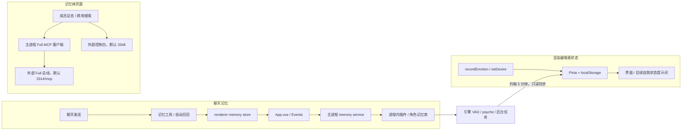

# AIRI「工具 → Castalia 情感循环 → 记忆体」源码审计报告

审计日期：2026-11-03

项目目录：`D:\AI\castalia-AIRI`

开始审计的提交：`30273df6e1e9a70a9459a5830a9c809e312bb93d`

完成审计时的提交：`713576093602ccaf996149446379bebc1cee2ba4`

两个提交之间只有 `.claude/skills` 变化。本文检查的产品源码没有变化。本次没有修改产品实现，只新增报告、审计探针和测试配置。

## 1. 审计结论

**这套功能有真实接线，但仍存在串角色、串会话、残留召回和失败伪装为正常结果的问题。不能用“开关已开启”或“记忆体在线”证明完整链路正常。**

本次列出 **12 项问题：3 项 P1，9 项 P2**。优先处理以下三个问题：

1. 第二个角色的自动召回，仍能取到首次装载角色的记忆。
2. 向非当前选中会话发送消息时，召回使用当前选中会话的查询和角色。
3. 召回未命中、异常、超时、关闭记忆或切换角色后，旧召回仍能进入下一次模型请求。

这三项均已复现。它们影响模型实际收到的内容，不能只通过观察设置页发现。

与“看似开启，实际没有反应”直接相关的另外几处问题：

- 条目读写后端不支持搜索，但搜索工具仍返回“没有匹配记忆”，并记录一次健康成功。
- 情感和欲望工具只修改渲染器状态。它们会影响界面和后续提示词，但没有写回引擎 psyche。
- 界面关闭模块，不会撤销主进程已经安排的情绪队列扫描、维护和自循环任务。
- “转为通用记忆”在持久化失败后仍呈现成功后的本地状态。
- Full 总线的部分 MCP 工具错误被解析为成功空结果。
- 控制台启动失败的常见返回分支，被页面直接隐藏。

同时，显式按角色搜索、普通写入和遗忘的失败反馈、VAD 超龄扫描、部分缓存刷新、调参和工具降级提示均有有效实现。不能据此把整个模块判定为“完全空接”。

## 2. 范围、方法和证据等级

### 2.1 范围

本次沿 Electron 桌面版入口检查以下部分：

| 范围 | 入口或实现 |
| --- | --- |
| 模块菜单及状态 | [use-modules-list.ts](/D:/AI/castalia-AIRI/packages/stage-ui/src/composables/use-modules-list.ts:199) |
| Castalia 情感循环页面 | [castalia.vue](/D:/AI/castalia-AIRI/apps/stage-tamagotchi/src/renderer/pages/settings/modules/castalia.vue:203) |
| “记忆体”页面及操作 | [memory/index.vue](/D:/AI/castalia-AIRI/apps/stage-tamagotchi/src/renderer/pages/settings/memory/index.vue:16) |
| 长期记忆开关和条目页面 | [memory-long-term.vue](/D:/AI/castalia-AIRI/packages/stage-pages/src/pages/settings/modules/memory-long-term.vue)、[memory-long-term-memories.vue](/D:/AI/castalia-AIRI/packages/stage-pages/src/pages/settings/modules/memory-long-term-memories.vue:75) |
| 聊天工具和自动召回 | [chat.ts](/D:/AI/castalia-AIRI/packages/stage-ui/src/stores/chat.ts:690)、[memory.ts](/D:/AI/castalia-AIRI/packages/stage-ui/src/stores/memory.ts:746) |
| Electron 接线与主进程任务 | [App.vue](/D:/AI/castalia-AIRI/apps/stage-tamagotchi/src/renderer/App.vue:102)、[castalia-memory.ts](/D:/AI/castalia-AIRI/apps/stage-tamagotchi/src/main/services/airi/castalia-memory.ts:309) |
| 进程内插件、角色分库、情绪引擎 | [castalia-inprocess.ts](/D:/AI/castalia-AIRI/apps/stage-tamagotchi/src/main/services/airi/castalia-inprocess.ts:137)、[bank/index.ts](/D:/AI/castalia-AIRI/packages/castalia-plugin/src/bank/index.ts:263) |
| Full 跨库工具和控制台启动 | [castalia-full.ts](/D:/AI/castalia-AIRI/apps/stage-tamagotchi/src/main/services/airi/castalia-full.ts:13)、[castalia-console.ts](/D:/AI/castalia-AIRI/apps/stage-tamagotchi/src/main/services/airi/castalia-console.ts:46) |

工具检查覆盖四个内置记忆工具、两个内置情感工具、自动召回，以及 Full 页面调用的两个跨库工具。不包含其他无关插件的全部工具。

### 2.2 方法和限制

- 检查调用方、Eventa 契约、主进程处理器、插件和引擎消费者，核对参数是否完整传递。
- 使用真实 Pinia store、真实聊天上下文组装、隔离的真实记忆引擎和本地 HTTP 协议桩复现问题。
- 引擎探针使用临时库和合成标记，并关闭嵌入。没有读取真实用户记忆库。
- 聊天探针替换模型服务边界，检查最终发送给模型的上下文。没有调用真实模型服务。
- Chromium 中运行了六个浏览器测试用例。
- 没有操作真实 Electron 窗口，没有进行真实用户实例的手动端到端测试，也没有生成截图。
- 没有验证用户实际运行的 Full 服务、控制台、模型端点、密钥或机器环境。

因此，本文能确认源码缺陷和受控条件下的实际行为。本文不能确认用户当前实例已经触发每一项问题。

### 2.3 等级定义

| 等级 | 本文含义 |
| --- | --- |
| P1 | 影响角色或会话隔离，能把错误来源的记忆送入模型请求 |
| P2 | 功能范围、错误反馈、持久化、状态或后台任务存在缺口 |
| 已复现 | 新增探针已经观察到所述行为 |
| 机制复现＋源码确认 | 已复现底层现象，具体漏接入口通过源码确认 |
| 源码确认 | 调用链或条件不一致已确认，没有执行相应真实运行场景 |

## 3. 实际上是三条独立链路



关键区别：

- 聊天自动召回和内置记忆工具，主要走本地进程内记忆链。
- 情感工具当前直接修改渲染器状态，没有对应的引擎情感写入调用。
- “记忆体”页的成员和跨库检索，走独立的 Full HTTP 总线。
- Full 页面在线，不等于聊天正在使用该总线，也不等于聊天召回的角色参数正确。
- 浏览器成功接到打开控制台的请求，不等于控制台服务可访问。

主进程分别注册 Full、控制台和本地记忆处理器。参见 [castalia-memory.ts](/D:/AI/castalia-AIRI/apps/stage-tamagotchi/src/main/services/airi/castalia-memory.ts:317)。

## 4. 问题总表

| 编号 | 等级 | 问题 | 证据 |
| --- | --- | --- | --- |
| A01 | P1 | 第二角色自动召回落到首次装载角色 | 已复现，真实隔离引擎 |
| A02 | P1 | 后台会话发送使用当前选中会话的查询和角色 | 已复现，Chromium 真实聊天 store |
| A03 | P1 | 旧召回在未命中、失败、超时、禁用和换角色后残留 | 已复现，五种情况 |
| A04 | P2 | 不支持搜索的后端返回“未命中”，健康计数增加 | 已复现，真实记忆 store 和工具 |
| A05 | P2 | 情感和欲望工具没有写回引擎 psyche | 源码确认 |
| A06 | P2 | 界面关闭模块不停止主进程后台任务 | 源码确认 |
| A07 | P2 | 维护与定时自循环只针对配置角色 | 源码确认 |
| A08 | P2 | “转为通用记忆”持久化失败后不回滚 | 已复现，真实记忆 store |
| A09 | P2 | 主进程新增记忆后仍有本地缓存刷新缺口 | 机制复现＋源码确认 |
| A10 | P2 | Full 的 MCP 工具错误被当成成功空结果 | 已复现，本地 HTTP 协议桩 |
| A11 | P2 | 控制台启动失败信息被页面隐藏 | 源码确认 |
| A12 | P2 | 情感状态接受的环境变量值与引擎条件不同 | 源码确认 |

## 5. 逐项证据和验收要求

### A01 — 第二角色自动召回仍读取首次装载角色

**影响：** 即使聊天层传入第二角色，自动召回仍能把第一角色的记忆送入上下文。

调用链存在两处遗漏：

- [castalia-inprocess.ts:141](/D:/AI/castalia-AIRI/apps/stage-tamagotchi/src/main/services/airi/castalia-inprocess.ts:141) 用 `ensure(persona)` 打开了相应角色，但调用 `bank.recallQuery(query, { recentIds })` 时没有传角色。
- [bank/index.ts:263](/D:/AI/castalia-AIRI/packages/castalia-plugin/src/bank/index.ts:263) 只补 `project`，没有补 bank 自己的 `charId`。
- [store-tools.ts:245](/D:/AI/castalia-AIRI/packages/castalia-plugin/src/bank/store-tools.ts:245) 缺少角色参数时，退回引擎首次加载时捕获的 `CHAR_ID`。

**复现：** 临时库中分别写入 `FIRST_CARD_SECRET` 和 `SECOND_CARD_SECRET`。显式指定第二角色的搜索、召回都只返回第二条。通过桌面适配器对第二角色自动召回，却返回第一条，且不返回第二条。

标记都是测试数据。探针见 [引擎审计测试](/D:/AI/castalia-AIRI/packages/castalia-plugin/audits/castalia-link-review-2026-11-03.test.ts:43)。

**边界：** 显式搜索已经传角色，并有通过的回归测试。不能把此问题扩大为“所有角色分库操作都失效”。

**验收：** 同一进程打开两个角色后，自动召回必须只返回请求角色及允许共享的通用记忆。交换首次打开顺序后，结果仍相同。

### A02 — 实际发送会话与召回会话不一致

**触发：** 当前选中会话 A，同时向未选中的会话 B 发送消息。

运行时已经把实际发送的 `sessionId` 传给 context provider，见 [chat-orchestrator-runtime.ts:610](/D:/AI/castalia-AIRI/packages/core-agent/src/runtime/chat-orchestrator-runtime.ts:610)。但记忆 provider 没有接收这个参数：

- [chat.ts:1068](/D:/AI/castalia-AIRI/packages/stage-ui/src/stores/chat.ts:1068) 从 `activeSessionId.value` 取查询文本。
- [chat.ts:356](/D:/AI/castalia-AIRI/packages/stage-ui/src/stores/chat.ts:356) 再从当前选中会话解析角色。

附近声称运行时不传参数的 NOTICE 注释，与当前运行时实现不符。

**复现：** A 的最后一句为 `SELECTED_QUERY`，B 发送 `ACTUAL_SENDING_QUERY`。最终模型上下文包含 B 的消息，但召回收到 `SELECTED_QUERY/default`。见 [浏览器审计测试](/D:/AI/castalia-AIRI/packages/stage-ui/audits/castalia-link-review-2026-11-03.browser.test.ts:71)。

**影响：** 后台发送、指定会话发送或并发场景能用错查询和角色。只有一个当前选中会话时，此缺陷不必然触发。

**验收：** 查询、角色和召回结果必须绑定实际发送的会话。发送过程中切换界面选中会话，不能改变该次请求的记忆范围。

### A03 — 旧召回不会随失败、禁用或角色切换清除

**根因：** “本次不添加上下文”没有删除上一次已存的上下文。

- [memory-recall.ts:54](/D:/AI/castalia-AIRI/packages/stage-ui/src/stores/chat/context-providers/memory-recall.ts:54) 在空结果、错误或 800 ms 超时后返回 `undefined`。
- [chat-orchestrator-runtime.ts:616](/D:/AI/castalia-AIRI/packages/core-agent/src/runtime/chat-orchestrator-runtime.ts:616) 直接跳过空结果。
- 成功召回使用固定的 `recalled` 来源，只有下一次成功写入时才执行 ReplaceSelf。
- [context-registry.ts:116](/D:/AI/castalia-AIRI/packages/core-agent/src/runtime/context-registry.ts:116) 保留来源桶。
- [context-store.ts:27](/D:/AI/castalia-AIRI/packages/stage-ui/src/stores/chat/context-store.ts:27) 创建共享 registry，没有按会话分别持有这份召回状态。
- [chat.ts:1020](/D:/AI/castalia-AIRI/packages/stage-ui/src/stores/chat.ts:1020) 把 registry 快照交给模型。

**复现：** 第一轮成功注入 `PRIVATE_RECALL_MARKER`。第二轮分别测试以下五种情况，最终模型请求仍包含该标记：

1. 本次召回没有命中。
2. 后端抛错。
3. 超过召回等待时限。
4. 关闭长期记忆。
5. 新建并切换到第二角色的会话。

关闭记忆的用例还确认：第二轮没有再次调用远端召回，但旧文本仍留在请求中。见 [浏览器审计测试](/D:/AI/castalia-AIRI/packages/stage-ui/audits/castalia-link-review-2026-11-03.browser.test.ts:88)。

**边界：** 显式聊天 cleanup 会重置上下文。问题出在普通发送和会话切换没有完成相应清理。

**验收：** 召回上下文必须属于当前请求和当前会话。未命中、失败、超时、禁用或切换角色时，前一次召回不能作为本次召回继续发送。

### A04 — 不支持搜索被包装成“没有匹配记忆”

**触发：** 完整引擎不可用，后端退到 `entry-only`。

主进程明确报告 `search=false`、`facts=false`，但仍给相应调用返回空数组。参见 [castalia-memory.ts:430](/D:/AI/castalia-AIRI/apps/stage-tamagotchi/src/main/services/airi/castalia-memory.ts:430)。

渲染器仍挂接相应函数，记忆工具只按 `memory.enabled` 注册。`lookup` 只检查方法存在，不检查后端能力。见 [App.vue:102](/D:/AI/castalia-AIRI/apps/stage-tamagotchi/src/renderer/App.vue:102)、[chat.ts:690](/D:/AI/castalia-AIRI/packages/stage-ui/src/stores/chat.ts:690)、[memory.ts:771](/D:/AI/castalia-AIRI/packages/stage-ui/src/stores/memory.ts:771)。

**复现：** 明确设置 entry-only 和能力全关闭后，搜索工具回答 `No memory matched`。同时 `okCount=1`、`remoteDegraded=false`。见 [记忆 store 审计测试](/D:/AI/castalia-AIRI/packages/stage-ui/audits/castalia-link-review-2026-11-03.test.ts:23)。

**影响：** 模型把“搜索根本没有运行”理解成“记忆中没有这件事”。健康指标也会被空返回抬高。

**边界：** Castalia 页已有后端能力提示。缺口是执行路径没有消费能力状态，并非完全没有诊断界面。

**验收：** 不支持的操作必须返回 unavailable，不能计为搜索成功，也不能回答事实不存在。工具注册和执行时都必须处理能力缺失。

### A05 — 情感和欲望工具只改变渲染器

涉及 `builtIn_castaliaRecordEmotion` 和 `builtIn_castaliaSetDesire`。

[chat.ts:690](/D:/AI/castalia-AIRI/packages/stage-ui/src/stores/chat.ts:690) 只把工具接到插件 store。[store.ts:35](/D:/AI/castalia-AIRI/packages/castalia-plugin/src/store.ts:35) 用 localStorage 保存状态。`recordEmotion` 和 `setDesire` 分别更新本地情感和欲望，见 [store.ts:113](/D:/AI/castalia-AIRI/packages/castalia-plugin/src/store.ts:113)。

现有 [Eventa 契约](/D:/AI/castalia-AIRI/apps/stage-tamagotchi/src/shared/eventa/castalia-memory.ts:121) 提供 psyche 读取，没有这两个工具对应的引擎情感写入操作。

**实际效果：** 工具能改变界面和后续自我状态提示词。它们没有把相应变化写入引擎 psyche，也没有据此驱动引擎的情感记忆排序或自循环。

引擎已有情感证据时，约每五分钟的只读同步还能覆盖本地 VAD。见 [App.vue:512](/D:/AI/castalia-AIRI/apps/stage-tamagotchi/src/renderer/App.vue:512)。

此外，[castalia-memory.ts:372](/D:/AI/castalia-AIRI/apps/stage-tamagotchi/src/main/services/airi/castalia-memory.ts:372) 的状态说明声称模型调用 recordEmotion 会改 psyche，与上述接线不符。

**证据等级：** 源码确认。没有在真实窗口中观察覆盖时序。

**验收：** 明确这两个工具的状态归属。如果产品承诺修改引擎情感，必须有可验证的写入和回读。如果只修改提示词状态，界面和工具反馈必须准确说明范围。

### A06 — 界面关闭模块，不会停止主进程后台调度

**触发：** 主进程已启动并安排任务后，用户关闭 Castalia 或长期记忆相关开关。

渲染器开关能拦截工具、提示词、psyche 轮询及部分 mind 发起的操作。对应 guard 已存在，见 [App.vue:515](/D:/AI/castalia-AIRI/apps/stage-tamagotchi/src/renderer/App.vue:515) 和 [App.vue:543](/D:/AI/castalia-AIRI/apps/stage-tamagotchi/src/renderer/App.vue:543)。

但没有把这个 enabled 状态传给主进程调度器：

| 任务 | 当前主进程调度 |
| --- | --- |
| VAD 超龄队列扫描 | 默认每 2 分钟，由 `VAD_SWEEP_MINUTES` 控制 |
| 记忆维护 | 启动 3 分钟后补跑。每 30 分钟检查一次本地 04:00–06:00 时间窗 |
| 自循环 | 启动 3 分钟后运行。默认间隔 360 分钟 |

参见 [VAD 调度](/D:/AI/castalia-AIRI/apps/stage-tamagotchi/src/main/services/airi/castalia-memory.ts:190)、[维护调度](/D:/AI/castalia-AIRI/apps/stage-tamagotchi/src/main/services/airi/castalia-memory.ts:209)、[自循环调度](/D:/AI/castalia-AIRI/apps/stage-tamagotchi/src/main/services/airi/castalia-memory.ts:251)。

**影响：** “关闭”的作用范围与用户对完整模块开关的理解不同。后台仍可处理先前积累的队列或执行自己的任务。

**证据等级：** 源码确认。没有等待真实定时周期。

**验收：** 给开关定义明确范围。如果它是完整模块开关，必须同步暂停相应后台调度。如果后台独立运行，界面必须单独显示和控制该范围。

### A07 — 维护和定时自循环只针对配置角色

[castalia-inprocess.ts:212](/D:/AI/castalia-AIRI/apps/stage-tamagotchi/src/main/services/airi/castalia-inprocess.ts:212) 的 maintain 调用 `ensure()`，没有角色参数。bank 内维护任务使用该 handle 的角色。

手动维护契约也只有 `limit`，没有角色，见 [castalia-memory.ts:139](/D:/AI/castalia-AIRI/apps/stage-tamagotchi/src/shared/eventa/castalia-memory.ts:139)。

主进程定时自循环同样不传 `characterId`，见 [castalia-memory.ts:268](/D:/AI/castalia-AIRI/apps/stage-tamagotchi/src/main/services/airi/castalia-memory.ts:268)。

**影响：** 第二角色可以写入自己的对话，但这些后台整理入口没有跟随它。界面显示任务开启，不代表当前角色会获得相同处理。

**必须区分的有效路径：**

- renderer mind 发起的自循环会传当前角色，见 [App.vue:546](/D:/AI/castalia-AIRI/apps/stage-tamagotchi/src/renderer/App.vue:546)。
- VAD 扫描会遍历所有已打开角色，见 [castalia-inprocess.ts:244](/D:/AI/castalia-AIRI/apps/stage-tamagotchi/src/main/services/airi/castalia-inprocess.ts:244)。
- 按会话写入的增量反思存在。不能据此声称第二角色完全没有反思。

**证据等级：** 源码确认。

**验收：** 明确任务针对当前角色、配置角色还是所有符合条件的角色。实际调度、日志和页面范围必须一致。

### A08 — “转为通用记忆”失败后仍保留成功外观

条目页直接调用 `memory.makeGeneral(entry)`，见 [memory-long-term-memories.vue:75](/D:/AI/castalia-AIRI/packages/stage-pages/src/pages/settings/modules/memory-long-term-memories.vue:75)。

[memory.ts:681](/D:/AI/castalia-AIRI/packages/stage-ui/src/stores/memory.ts:681) 先把本地条目移为通用，再分别发起删除和保存：

- 两个远端操作独立执行，没有等待整体结果。
- 删除返回 false 不作失败处理。
- 保存抛错后只记健康失败，不回滚本地条目。
- 删除只传名称和 persona，没有传来源行 ID。

最后一点对引擎原始行尤其不可靠。原始行的派生 `mem-*` 名称不能保证命中按 store 名称查找的删除逻辑，见 [store-tools.ts:234](/D:/AI/castalia-AIRI/packages/castalia-plugin/src/bank/store-tools.ts:234)。

**复现：** 远端删除返回 false，保存抛错。本地条目仍成为通用，其他角色能通过本地 read 读到。重新 hydrate 后，条目又恢复为原角色私有。见 [记忆 store 审计测试](/D:/AI/castalia-AIRI/packages/stage-ui/audits/castalia-link-review-2026-11-03.test.ts:52)。

**边界：** 普通写入和遗忘工具已有等待持久化及失败回滚。这一操作没有复用相同保障。

**验收：** 使用稳定 ID 确认源条目。完整迁移失败后，页面必须恢复原状态并显示失败原因。只有持久化完成后才能呈现迁移成功。

### A09 — 后端新记忆到本地 read 和索引仍有刷新缺口

`builtIn_readMemory` 和提示词索引依赖本地缓存。后端搜索直接查库，两者不是相同数据源。

已有 `scheduleRefresh`，默认延迟 2 秒，但必须由调用方显式触发，见 [memory.ts:489](/D:/AI/castalia-AIRI/packages/stage-ui/src/stores/memory.ts:489)。

目前已接通的入口包括对话 ingest 成功，以及 renderer think/sleep 的成功操作。仍缺少：

- 主进程定时维护和定时自循环生成新行后的通知。
- “记忆体”页手动维护后，对 renderer memory store 的刷新。见 [memory/index.vue:30](/D:/AI/castalia-AIRI/apps/stage-tamagotchi/src/renderer/pages/settings/memory/index.vue:30)。

**复现与证据范围：** 既有审计探针证明，后端新增行已经能被 search 找到，但本地 read 和索引在 hydrate 前找不到。见 [缓存探针](/D:/AI/castalia-AIRI/packages/stage-ui/audits/castalia-wiring-2026-11-03.test.ts:95)。上述两个具体入口没有刷新，由源码确认。没有把这条机制探针当成真实定时任务的端到端测试。

**影响：** 新记忆能被搜索到，界面或模型本地索引却看不到。用户会遇到“维护完成但好像没有变化”。

**验收：** 所有能生成、删除或整合条目的后台入口，完成后必须使受影响缓存失效或刷新。无需重启应用即可通过 read 和索引观察最终状态。

### A10 — Full 忽略 MCP 的工具错误标记

[castalia-full.ts:113](/D:/AI/castalia-AIRI/apps/stage-tamagotchi/src/main/services/airi/castalia-full.ts:113) 检查 JSON-RPC 外层 `error`，没有检查 `result.isError`。随后把 content 文本当 JSON 数据解析。

**复现：** 本地 HTTP 协议桩返回：

```json
{
  "jsonrpc": "2.0",
  "id": 3,
  "result": {
    "isError": true,
    "content": [
      { "type": "text", "text": "{\"error\":\"member unavailable\"}" }
    ]
  }
}
```

`members()` 和 `search()` 都返回 `ok:true`，并把缺失的数据字段转为空数组、零条结果。见 [Full 协议审计测试](/D:/AI/castalia-AIRI/apps/stage-tamagotchi/audits/castalia-link-review-2026-11-03.test.ts:16)。

**影响：** 部分真实工具故障能显示成“在线但没有内容”。

**边界：** HTTP 失败、外层 JSON-RPC 错误和无法解析为 JSON 的文本错误，已有失败处理。此问题针对带有效 JSON 文本的 MCP 工具错误。

另外有两个静态缺口：

- [ensureSession:94](/D:/AI/castalia-AIRI/apps/stage-tamagotchi/src/main/services/airi/castalia-full.ts:94) 只要保留 sessionId 就不初始化。服务重启或会话失效后，客户端没有清除并重新握手的路径。
- 成员 `ok` 被映射，但页面成员按钮没有用它表达成员故障。见 [memory/index.vue:224](/D:/AI/castalia-AIRI/apps/stage-tamagotchi/src/renderer/pages/settings/memory/index.vue:224)。

这两个补充项没有运行对应服务场景，不计入已复现结果。

**验收：** MCP 工具错误必须返回失败且保留原因。总线状态、成员状态和零命中必须能区分。失效会话必须有受控重新握手路径。

### A11 — 控制台打开失败被页面隐藏

[castalia-console.ts:46](/D:/AI/castalia-AIRI/apps/stage-tamagotchi/src/main/services/airi/castalia-console.ts:46) 捕获 `shell.openExternal` 的异常后返回 `ok:false,error`。

但 [memory/index.vue:71](/D:/AI/castalia-AIRI/apps/stage-tamagotchi/src/renderer/pages/settings/memory/index.vue:71) 丢弃 error，只设置 `consoleNote='failed'`。模板又明确排除 failed，见 [memory/index.vue:197](/D:/AI/castalia-AIRI/apps/stage-tamagotchi/src/renderer/pages/settings/memory/index.vue:197)。

**影响：** 点击“打开控制台”“管理”或“星图”后，常见失败分支没有可见说明，符合“按了没反应”的表现。

**证据等级：** 源码确认。没有操作真实系统浏览器。

**验收：** 返回失败和抛错都必须显示可读原因。成功提示必须区分“已请求浏览器打开”和“目标服务已确认可访问”。

### A12 — 状态显示“自动情感开启”，引擎却拒绝该值

状态处理器会转小写，并接受 `on`、`1`、`true`，见 [castalia-memory.ts:368](/D:/AI/castalia-AIRI/apps/stage-tamagotchi/src/main/services/airi/castalia-memory.ts:368)。

引擎只接受严格的 `process.env.PSYCHE_FROM_VAD === 'on'`，见 [emotion.ts:1111](/D:/AI/castalia-AIRI/packages/castalia-plugin/src/vendor/engine/emotion.ts:1111)、[emotion.ts:1152](/D:/AI/castalia-AIRI/packages/castalia-plugin/src/vendor/engine/emotion.ts:1152) 和 [emotion.ts:1170](/D:/AI/castalia-AIRI/packages/castalia-plugin/src/vendor/engine/emotion.ts:1170)。

**触发：** 环境值为 `1`、`true` 或大写 `ON`。页面状态报告开启，VAD 到 psyche 的推进条件仍为 false。

**证据等级：** 源码条件直接不一致，没有针对这些别名值新增运行测试。

**边界：** 此变量不是调参清单中的面板控件。本项指环境配置和状态说明不一致，不能描述为已经验证了某个页面开关失效。

**验收：** 状态报告与执行逻辑共用同一解析规则。每一种被报告为开启的值，都必须能通过引擎入口验证。

## 6. 工具实际使用范围

| 入口 | 实际操作 | 主要前提或限制 |
| --- | --- | --- |
| `builtIn_readMemory` | 同步读取 renderer 本地条目缓存 | 不会临时向后端搜索。受 A09 影响 |
| `builtIn_searchMemory` | 调用后端 search 和 facts | 不是自动召回。entry-only 能力判断有 A04 |
| `builtIn_writeMemory` | 本地更新后等待远端持久化 | 失败反馈和回滚已有通过的测试 |
| `builtIn_forgetMemory` | 按角色删除并等待持久化结果 | 普通遗忘已有失败回滚。不同于 A08 |
| `builtIn_castaliaRecordEmotion` | 修改 renderer 情感和 VAD | 会影响后续提示词。没有引擎写回，见 A05 |
| `builtIn_castaliaSetDesire` | 修改 renderer 当前欲望 | 保存到 localStorage 并参与后续自我状态 |
| 自动召回 provider | 每次发送前检索并注入上下文 | 不要求模型主动调用工具。存在 A01–A03 |
| Full `federation_members` | “记忆体”页读取跨库成员 | 依赖外部 Full 总线 |
| Full `memory_search_all` | “记忆体”页跨库搜索 | 与聊天内置 search 的调用链不同 |

工具定义见 [memory.ts](/D:/AI/castalia-AIRI/packages/stage-ui/src/tools/memory.ts:9) 和 [castalia.ts](/D:/AI/castalia-AIRI/packages/stage-ui/src/tools/castalia.ts:7)。

**启用工具不保证模型主动调用。** 还取决于服务商、模型工具支持和本次生成行为。当前已有工具能力降级记录、页面提示和重试按钮，见 [castalia.vue:230](/D:/AI/castalia-AIRI/apps/stage-tamagotchi/src/renderer/pages/settings/modules/castalia.vue:230)。本次没有证据证明用户真实模型已经成功调用这些工具。

## 7. 自动情感为什么会“没有变化”

自动情感至少需要以下条件同时满足：

1. 对话已进入引擎 autoProcess 路径。桌面主进程默认补 `MEMORY_AUTO_PROCESS=1`。
2. 队列达到处理条件，或被超龄扫描处理。
3. 分析器给出可接受的 VAD，而不是 abstain。
4. `PSYCHE_FROM_VAD` 在引擎里严格等于 `on`。
5. 处理结果形成有效情感证据，随后 renderer 才能同步 psyche。

自动开启 autoProcess 不等于开启 VAD 到 psyche 的门槛。

本次重新运行的隔离探针已经证明：

| 受控条件 | 观察结果 |
| --- | --- |
| 模型返回有效 VAD，但门槛未开 | 没有 psyche 证据 |
| 门槛开启，但测试词句由本地词表处理 | 测试输入被 abstain，没有 psyche 证据 |
| 相同有效模型结果，且门槛为 on | psyche 推进 |

相关用例见 [既有引擎审计探针](/D:/AI/castalia-AIRI/packages/castalia-plugin/audits/castalia-wiring-2026-11-03.test.ts:173)。

词表结果只适用于测试词句，不能扩大为“词表永远无效”。本次没有验证真实模型端点是否可用。

### 调参接线没有发现同类空接证据

本次核对确认：

- `TUNING_SUPPORT=null` 表示支持完整清单，不表示没有支持项。
- 参数存在白名单、范围和重启标记。
- 保存的环境值在引擎导入前应用。
- 清除覆盖值会移除对应环境变量。
- 搜索类参数需要重启。部分 psyche 参数在使用时读取。
- `PSYCHE_FROM_VAD` 不在该面板调参清单内。

参见 [castalia-tuning.ts](/D:/AI/castalia-AIRI/apps/stage-tamagotchi/src/main/services/airi/castalia-tuning.ts:67)。因此，不能把上述自动情感门槛问题归因成“所有滑块都没有接线”。

## 8. 已确认有效的路径

以下结果有助于界定修复范围：

| 路径 | 本次证据 |
| --- | --- |
| 显式搜索按角色隔离 | 既有审计测试通过，第二角色获得第二角色结果 |
| 按 hydrate 行 ID 删除第二角色条目 | 既有审计测试通过 |
| 搜索包含通用记忆 | 既有审计测试通过 |
| 普通写入、遗忘失败后不虚报完成 | store 和工具回归测试通过 |
| 后端 search 抛错 | 返回 failed lookup，而不是“没有记忆” |
| VAD 超龄队列扫描 | 引擎测试通过，主进程已有定时调用 |
| 扫描覆盖已打开角色 | 适配器有显式遍历 |
| ingest 及 renderer think/sleep 后刷新 | 已有 `scheduleRefresh` 调用 |
| 傲娇程度设置进入提示词 | 既有审计测试通过 |
| 维护冷却和跳过反馈 | 相关维护测试通过 |
| 后端能力和模型工具降级提示 | 页面已有显示与重试入口 |

较早的两份报告保留在 [首次审计报告](/D:/AI/castalia-AIRI/docs-notes/audits/castalia-tools-memory-2026-11-03/report.md) 和 [修复后复查](/D:/AI/castalia-AIRI/docs-notes/audits/castalia-tools-memory-2026-11-03/review-after-fix.md)。本文用 A01–A12 编号，避免与其中的旧编号混淆。

部分修复已经生效，但本文复现证明剩余边界仍不完整，尤其是自动召回和普通显式搜索之间的差异。

## 9. 验证命令和结果

以下命令从仓库根目录执行。仅列出实际运行的验证，不代表所有 workspace 测试或真实 Electron 端到端场景通过。

### 9.1 原有测试和既有审计探针

**V01 — Castalia 插件完整测试**

```powershell
pnpm -F @proj-airi/castalia-plugin exec vitest run
```

首次结果为 101/102。失败受继承的 `PSYCHE_BAND_*` 环境值影响。在测试子进程内清除这三个环境变量后重新运行：

```powershell
Remove-Item Env:PSYCHE_BAND_CENTER_OFFSET,Env:PSYCHE_BAND_ENTER,Env:PSYCHE_BAND_HOLD -ErrorAction SilentlyContinue
pnpm -F @proj-airi/castalia-plugin exec vitest run
```

最终结果：**14 个文件，102 个测试通过，退出码 0**。

**V02 — stage-ui 相关测试**

```powershell
pnpm -F @proj-airi/stage-ui exec vitest run --project node src/stores/memory.test.ts src/stores/memory.remote.test.ts src/stores/castalia-path.test.ts src/tools/memory.test.ts src/tools/castalia.test.ts src/stores/chat/context-providers/memory-recall.test.ts
```

结果：**6 个文件，52 个测试通过，退出码 0**。

**V03 — 桌面适配器、配置和调参测试**

```powershell
pnpm -F @proj-airi/stage-tamagotchi exec vitest run --project node src/main/services/airi/castalia-config.test.ts src/main/services/airi/castalia-inprocess.test.ts src/main/services/airi/castalia-tuning.test.ts
```

结果：**3 个文件，20 个测试通过，退出码 0**。

**V04 — 既有隔离审计探针**

```powershell
pnpm exec vitest run --config docs-notes/audits/castalia-tools-memory-2026-11-03/vitest.config.ts
```

结果：**2 个文件，15 个测试通过，退出码 0**。

### 9.2 本次新增缺陷探针

**注意：新增探针断言的是当前缺陷行为。通过表示复现成功，不表示问题已经修复。**

**V05 — Node 探针**

```powershell
pnpm exec vitest run --config docs/ai/audits/castalia-link-review-2026-11-03/vitest.config.ts
```

结果：**3 个文件，4 个测试通过，退出码 0**。覆盖 A01、A04、A08、A10。

**V06 — Chromium 聊天链路探针**

```powershell
pnpm exec vitest run --config docs/ai/audits/castalia-link-review-2026-11-03/vitest-browser.config.ts
```

结果：**1 个文件，6 个测试通过，退出码 0**。覆盖 A02，以及 A03 的五种情况。

运行中有非致命的原生加载扩展和 i18n 警告，以及探针有意制造的召回失败日志。测试完成后，针对样式调整重跑了 V05、V06，结果仍通过。

### 9.3 Lint

**V07 — 新增审计代码定向检查**

```powershell
pnpm exec eslint docs/ai/audits/castalia-link-review-2026-11-03/vitest.config.ts docs/ai/audits/castalia-link-review-2026-11-03/vitest-browser.config.ts packages/castalia-plugin/audits/castalia-link-review-2026-11-03.test.ts packages/stage-ui/audits/castalia-link-review-2026-11-03.test.ts packages/stage-ui/audits/castalia-link-review-2026-11-03.browser.test.ts apps/stage-tamagotchi/audits/castalia-link-review-2026-11-03.test.ts
```

首次发现 5 个样式错误，已经修正。最终结果：**通过，退出码 0**。

**V08 — 全仓库 Lint**

```powershell
pnpm lint
```

首次为 600 个错误、459 个警告。修正本次审计代码后重跑，最终为 **595 个错误、459 个警告，退出码 1**。

剩余错误涉及已有探针和多处其他文件。本次没有顺手修改产品源码或无关文件。不能报告仓库 lint 通过。

日志：[castalia-link-review-2026-11-03-lint.log](/C:/Users/1/AppData/Local/Temp/castalia-link-review-2026-11-03-lint.log)。

### 9.4 Typecheck

| 编号 | 实际命令 | 结果 |
| --- | --- | --- |
| V09 | `pnpm typecheck` | 失败，退出码 2。Turbo 在 castalia-plugin 类型错误处停止 |
| V10 | `pnpm -F @proj-airi/castalia-plugin typecheck` | 失败，退出码 2。`psyche-layered.test.ts:227` 出现 TS2322 |
| V11 | `pnpm -F @proj-airi/stage-ui typecheck` | 失败，退出码 2。113 条 TypeScript 诊断 |
| V12 | `pnpm -F @proj-airi/stage-tamagotchi typecheck` | 失败，退出码 2。36 条 TypeScript 诊断 |

主要阻塞包括：

- `psyche-layered.test.ts` 的可选 `valenceBias` 与必需 number 类型冲突。
- stage-ui 的官方 provider 导入、缺失方法，以及 airi-card 重复函数。
- 桌面 auto-updater API 不匹配及传递进来的 stage-ui 错误。

这些诊断没有指向本次新增审计文件。产品源码没有修改。本次没有建立“仓库可完整构建”的结论。

日志：[根 typecheck](/C:/Users/1/AppData/Local/Temp/castalia-link-review-2026-11-03-typecheck.log)、[stage-ui typecheck](/C:/Users/1/AppData/Local/Temp/castalia-link-review-2026-11-03-typecheck-stage-ui.log)、[桌面 typecheck](/C:/Users/1/AppData/Local/Temp/castalia-link-review-2026-11-03-typecheck-desktop.log)。

没有运行完整构建，没有验证 CI，也没有进行真实 Electron 手动端到端测试。

### 9.5 报告交付检查

**V13 — 报告和六个新增证据文件的最终 Lint**

```powershell
pnpm exec eslint docs/ai/audits/castalia-link-review-2026-11-03/report.md docs/ai/audits/castalia-link-review-2026-11-03/vitest.config.ts docs/ai/audits/castalia-link-review-2026-11-03/vitest-browser.config.ts packages/castalia-plugin/audits/castalia-link-review-2026-11-03.test.ts packages/stage-ui/audits/castalia-link-review-2026-11-03.test.ts packages/stage-ui/audits/castalia-link-review-2026-11-03.browser.test.ts apps/stage-tamagotchi/audits/castalia-link-review-2026-11-03.test.ts
```

首次发现报告三行 Markdown 行尾空格，已经移除。最终结果：**通过，退出码 0**。

另通过 Node 脚本检查报告全部本地文件链接，确认目标文件存在，引用行号没有超出文件。

## 10. 后续处理顺序

| 顺序 | 处理内容 | 完成标准 |
| --- | --- | --- |
| 1 | A01、A02、A03：修复召回角色、会话和生命周期 | 双角色、后台发送、失败和禁用后，模型上下文不串线、不残留 |
| 2 | A04、A10、A11、A12：统一能力与错误反馈 | 不支持、失败、零命中、开启和实际执行结果可区分 |
| 3 | A08：修复通用记忆迁移的持久化一致性 | 稳定 ID、完成确认、失败回滚、重读一致 |
| 4 | A05、A06、A07：明确情感状态和后台任务的控制范围 | 工具反馈、引擎状态、开关和角色范围一致 |
| 5 | A09：补齐后台生成记忆后的缓存失效 | 维护或自循环完成后，无需重启即可 read 和索引读取 |

修复时，把本次证明缺陷的断言转换为防止缺陷的回归断言，并保留现有有效路径的检查。

接下来真实实例的验收重点是：记录实际发送会话、解析角色、后端能力、召回来源和最终上下文，同时观察引擎情感证据。只看设置开关或界面心情值不足以验收。

本次交付止于审计。上述产品问题尚未修改。

## 11. 本次新增证据文件

- [Node 测试配置](/D:/AI/castalia-AIRI/docs/ai/audits/castalia-link-review-2026-11-03/vitest.config.ts)
- [Chromium 测试配置](/D:/AI/castalia-AIRI/docs/ai/audits/castalia-link-review-2026-11-03/vitest-browser.config.ts)
- [真实引擎角色召回探针](/D:/AI/castalia-AIRI/packages/castalia-plugin/audits/castalia-link-review-2026-11-03.test.ts)
- [记忆能力与迁移探针](/D:/AI/castalia-AIRI/packages/stage-ui/audits/castalia-link-review-2026-11-03.test.ts)
- [聊天会话与旧召回探针](/D:/AI/castalia-AIRI/packages/stage-ui/audits/castalia-link-review-2026-11-03.browser.test.ts)
- [Full MCP 工具错误探针](/D:/AI/castalia-AIRI/apps/stage-tamagotchi/audits/castalia-link-review-2026-11-03.test.ts)

